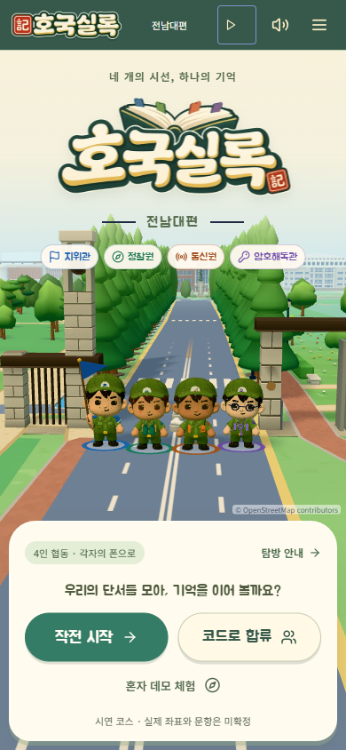
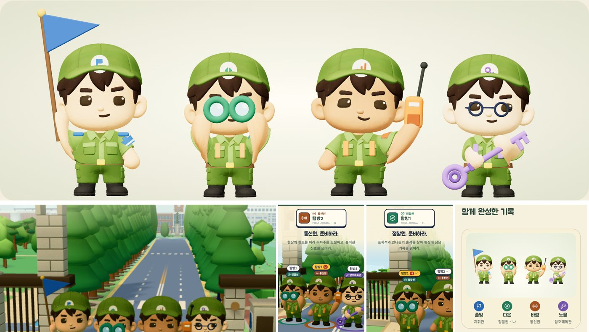
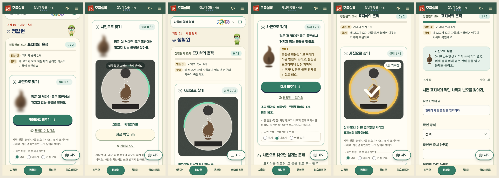
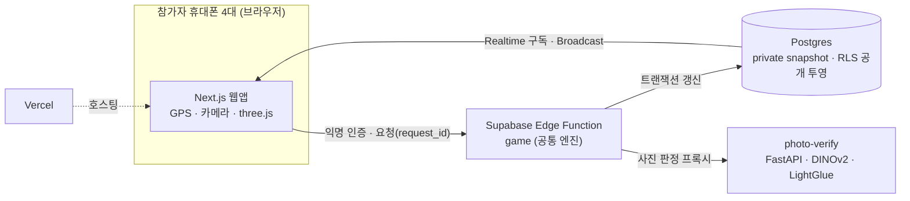

# 호국실록 — 기억을 잇는 전남대편

> 네 명이 각자 휴대폰을 들고 역사 현장을 걸으며, 보직마다 다른 단서를 풀고 말로 공유해 함께 자물쇠를 여는 **GPS 기반 협동형 보훈·역사 현장 교육 웹 게임**

2026 군학연계 프로그램(상무대근무지원단 × 전남대학교) 프로젝트입니다. 2026-09 기획을 시작해 2026-11-14 성과발표회와 학술대회 발표로 마무리했습니다.

**상태: 종료(2026-11-14)** · 이 저장소는 결과물 보관과 포트폴리오용으로 정리했으며 더 개발하지 않습니다.

<p align="center">
  
  &nbsp;
  
</p>

## 왜 만들었나

장병 정신전력 교육은 매주 정기 교육과 연 2회 집중 교육으로 이루어지지만 이론과 영상 시청이 중심입니다. 그래서 내용을 깊이 체감하고 행동으로 옮기기 어렵습니다. 상무대에서 받은 제안서(GPS 미션·보직 분담·현장 참여)를 바탕으로, **강의를 듣는 대신 직접 걷고 동료와 협력해 기억하는 교육**을 목표로 삼았습니다.

팀 협동을 "모두에게 할 일이 있고, 서로의 단서가 있어야 풀리는" 규칙으로 구체화했습니다. 한 사람이 모든 답을 알 수 없도록 단서와 숫자를 보직별로 나누고, 마지막 자물쇠는 네 사람이 말로 공유한 숫자를 지휘관이 모아 입력해야 열립니다.

## 플레이 흐름

| 거점 | 내용 |
|---|---|
| 1. 전남대 정문 | 보직마다 다른 도구로 단서 찾기. 정찰원은 카메라로 5·18 사적지 표지석 불꽃 문양을 찍어 판정받음 |
| 2. 용봉관 (약 390m) | 전시물과 설명판에서 흩어진 자료를 맞춰 기록 채우기 |
| 3. 용봉열사 추모의 벽 (약 350m) | 점수 경쟁 없이 각자 국화 한 송이 헌화 |
| 4. 봉지 (약 180m) | 회고를 종이배에 담아 띄우고 함께 완성한 기록(사초) 확인 |

**보직별 플레이**

- **지휘관(조율)**: 동료의 숫자를 모아 팀 자물쇠를 입력하고 이동을 이끈다
- **정찰원(관찰)**: 현장을 관찰하고 사진으로 단서를 찾는다
- **통신원(청취)**: 주파수를 맞춰 무전 속 단서를 찾는다
- **암호해독관(해독)**: 기호의 규칙을 추리해 암호를 푼다

<p align="center">
  
</p>

## 주요 기능

- **설치·가입 없이 입장**: 방 코드·QR로 합류하고 Supabase 익명 인증으로 바로 시작합니다.
- **GPS 도착 판정**: 위치를 세 번 측정해 평균을 내고, 반경 10m 안에 5초 머물면 도착으로 봅니다. 오차가 40m를 넘는 측정값은 버리고, 네 명이 모두 도착해야 다음 단계가 열립니다.
- **서버 판정과 정보 분리**: 정답 비교, 단계 전이, 보직 권한 확인을 Edge Function이 맡습니다. 다른 보직의 단서는 요청해도 거절하고, 다른 사람의 폰을 봐도 내 답이 나오지 않습니다.
- **찍기 방지**: 자물쇠는 3회까지 시도할 수 있습니다. 틀리면 −10점이고, 3회를 모두 쓰면 60초 동안 대기합니다.
- **실시간 4인 동기화**: 한 사람의 보고(✓)가 Supabase Realtime으로 나머지 화면에 바로 반영되고, 재접속하면 진행 상태를 복구합니다.
- **현장 사진 판정**: DINOv2 전역 유사도와 ALIKED + LightGlue 특징점 매칭을 함께 써서 정찰원 사진이 기준 장소와 같은지 판정합니다(별도 Python 서버).
- **3D 캠퍼스 지도**: Blender로 만든 거점 모델을 three.js 지도에 배치했고, 충돌 처리·확대·내 위치 표시를 지원합니다.
- **혼자 체험·자동 시연·폰 목업 보기**: 휴대폰 한 대로 전체 흐름을 체험할 수 있고, 발표용 자동 시연과 폰 틀 보기를 제공합니다.

## 아키텍처



- 공통 게임 엔진(`web/supabase/functions/_shared/engine.ts`)을 로컬 데모 서버와 Edge Function이 함께 써서, 로컬에서도 운영과 같은 규칙으로 시험합니다.
- 공개 투영에는 보고 ✓, 잠금 여부, 점수·단계, 호출명만 담습니다. 단서와 숫자는 본인 응답으로만 내려갑니다.
- 사진 판정 서버는 일치 여부와 재촬영 요청만 앱에 전달하고, 점수와 사진은 저장하지도 전달하지도 않습니다.

## 기술 스택

| 영역 | 사용 기술 |
|---|---|
| 프론트엔드 | Next.js 16 (App Router), React 19, TypeScript, Tailwind CSS, three.js · glTF |
| 백엔드 | Supabase (Postgres, Realtime, Edge Functions, 익명 인증), Deno |
| 사진 판정 | Python, FastAPI, PyTorch, DINOv2 + GeM, ALIKED + LightGlue, MAGSAC, Docker |
| 배포 | Vercel, Supabase |
| 테스트 | Vitest(70개 파일, 559개 테스트), PGlite(실제 Postgres 엔진으로 RLS 시험), Playwright, axe, pytest, GitHub Actions |

## 결과

- **실제 휴대폰 4대로 현장 완주 시험**과 플레이 피드백 반영을 마쳤습니다. 폰 UX 개선 13건이 대표적인 반영 사례입니다(예: 자물쇠 2.6초 열림 장면, 아이폰 숫자 칸 자동 이동, 3D 지도 충돌 처리).
- **사진 판정(정문)**: 11/4 낮에 찍은 정답 사진 86/86장을 통과시키고, 정문 근처 오답·무관 사진 38/38장을 거절했습니다. 전체 유사도만으로는 정답(0.924)과 오답(0.923)을 가를 수 없었지만, 특징점 일치 수(정답 최저 146 vs 오답 최고 29)로는 분명히 갈렸습니다. 표본이 작아 오인식률은 주장하지 않습니다. 지연은 컨테이너(2 vCPU) 기준 서버 처리 p95가 1,743ms였습니다([측정 기록](photo-verify/docs/LATENCY.md)).
- **성과**: 2026 추계학술대회 논문 제출, 2026-11-14 군학연계 프로그램 후반기 성과발표회와 학술대회 발표

## 팀

| 이름 | 역할 |
|---|---|
| 김동욱 ([@KIMDONGWOOK-KR1](https://github.com/KIMDONGWOOK-KR1)) | PM · 코드/논문 리뷰 · PR 머지 · 현장 사진 판정(photo-verify) 설계·구현 |
| 이환희 ([@dlghskgmll](https://github.com/dlghskgmll)) | 프론트엔드 · 디자인 · 논문 작성 |
| 김종연 ([@JongYoun0216](https://github.com/JongYoun0216)) | 백엔드 · GPS · 통합 · 배포 |
| 장민호 | 백엔드 · 시나리오 · 현장 답사 |

상무대근무지원단 이준혁 · 홍일 · 남방우 님이 초기 아이디어를 제안하고 논문을 함께 썼습니다.

협업은 기능 브랜치 → PR → PM 리뷰 → 수정 → PM 머지 순서로 진행했습니다(PR 20건, CI에서 타입 검사·단위 테스트·빌드·Edge 함수 검사).

## 저장소 구조

```
web/            Next.js 웹앱 + Supabase(migrations, Edge Functions) + 테스트
photo-verify/   현장 사진 판정 모델·평가 도구·FastAPI 추론 서버
GPS/            GPS 실측 로그 분석 도구
docs/           기획·설계·API 계약·시나리오·발표 Q&A (안내: docs/README.md)
.github/        CI 워크플로, PR 양식
```

## 로컬에서 실행

Node.js 22.9 이상이 필요합니다. 외부 서비스 없이 로컬 합성 데모로 실행합니다.

```bash
cd web
npm ci
npm run dev          # http://localhost:3000 → "혼자 데모 체험"
npm test             # 단위·통합 테스트
```

사진 판정 서버는 [photo-verify/README.md](photo-verify/README.md), Supabase·Vercel 연결은 [web/README.md](web/README.md)와 [배포 안내](docs/be/DEPLOY.md)를 참고하세요.

## 자료 관리 원칙

운영할 때는 정답·기준 사진·판정 임계값·원시 GPS 기록을 서버 전용 저장소와 `private/`(Git 제외)에만 두었습니다. 프로젝트를 마친 뒤 시연용 정문 도감 코스의 문항 정답은 [`dogam-course-v2.ts`](web/supabase/functions/_shared/dogam-course-v2.ts)에 포함된 채 공개했습니다. 기준 사진과 현장 원본 사진은 공개하지 않습니다.
