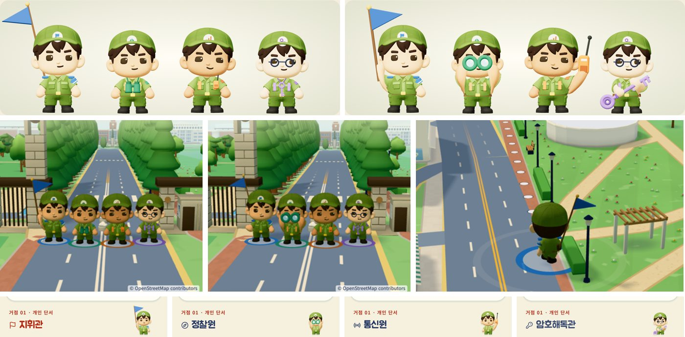

# 보직별 캐릭터 특징 · 2026-10-26

hh가 보내 준 참고 그림(점토 질감의 장병 넷이 각자 소품을 든 모습)처럼, 네 보직이 소품과 자세만 봐도 구분되게 했다. 기존 C02 장병 모형과 걷기·서기 동작은 그대로 쓰고, 소품은 지금처럼 기본 도형을 구워 붙였다. 새 3D 파일이나 블렌더·힉스필드 생성물은 쓰지 않았다(비용 없음, 모바일 용량 그대로).

| 보직 | 평소(걷기·서기) | 활동할 때 | 늘 몸에 단 것 |
|---|---|---|---|
| 지휘관 | 등에 비스듬히 꽂은 파란 깃발 | 오른손으로 깃발을 높이 든다 | 왼팔 파란 완장, 어깨 견장 |
| 정찰원 | 목에 건 초록 쌍안경 | 두 손으로 쌍안경을 눈에 댄다 | 황토색 멜빵과 작은 배낭 |
| 통신원 | 멜빵에 꽂은 주황 무전기 | 왼손으로 무전기를 귀에 댄다 | 등 무전기, 주황 멜빵 |
| 암호해독관 | 보라 열쇠 목걸이 | 두 손으로 큰 열쇠를 비스듬히 든다 | 보라 멜빵 (안경은 사람마다 정해지는 기존 규칙 유지) |

hh 피드백(같은 날): 늘 자세를 잡고 다니면 어색하다 → 평소에는 소품을 넣어 두고, 활동할 때만 꺼내 든다.

**활동 자세가 나오는 때**
- 문제 풀이 화면: 머리 오른쪽에 내 장병이 소품을 들고 조사하는 작은 초상(한 번 그린 그림이라 문제를 푸는 동안 3D를 계속 그리지 않는다). 헌화·회고 단계는 평소 모습.
- 대기실에서 보직을 공개하는 순간 약 3초.
- 이동 화면에서 도착 범위 안에 들어섰을 때(현장 조사). 추모 거점으로 가는 길과 조용한 구역에서는 꺼내지 않는다.
- 첫 화면에서 네 사람이 차례로 한 명씩 약 2초씩(동물의 숲 주민의 짧은 몸짓처럼).
- 결과 화면의 단체 사진은 기념사진처럼 모두 들고 선다.

모든 장병에 갈색 허리띠와 노란 버클을 더했다.

## 만든 방법

- `web/components/soldier-props.ts`: 소품마다 손잡이 위치를 적고, 매 장면 동작을 튼 뒤 두 마디 팔 뻗기(IK)로 손을 손잡이에 댄다. 이 모형은 팔이 짧아서 소품을 쥔 팔만 위팔을 1.32배 고르게 키운다. 동작 믹서가 값이 바뀔 때만 다시 쓰기 때문에, 처음 크기를 기억했다가 매번 그 크기에서 새로 정한다(곱하기가 쌓이면 팔이 끝없이 커진다).
- 넣고 꺼낼 때(0.45초) 넣어 둔 소품이 작아지며 사라지고 든 소품이 튀어나오며, 팔도 함께 올라가고 내려간다. 보직 공개 순간에는 바로 든 모습으로 튀어나온다.
- 장병 API: `setAction(on)`(상태가 이어지는 동안), `emote(초, 바로)`(잠깐), `setCalm(on)`(추모·조용한 구역에서는 활동 자세 금지). `CharacterLineup action`, `RolePortrait`(문제 화면 초상).
- 묵념 장면(`gather-stage.tsx`)과 추모 거점으로 가는 길·조용한 구역(`field-3d.tsx`)은 늘 평소 모습이다.

## 확인

- 디자인 검토 화면(`/design-review`, "평소 모습/활동할 때" 전환), 첫 화면 차례 몸짓, 대기실, 이동, 묵념, 문제 화면 초상, 결과 화면에서 실제로 그려 확인했다.
- Vitest 40개 파일 361개, TypeScript 검사, Chrome 시험 5개(협동 탐방, 좁은 화면 2개, 안내·음량 설정, 전체 코스) 통과.
- 첫 화면(장병 넷)의 스크립트 시간은 초당 약 51ms에서 58ms로 늘었다(헤드리스 Chrome 측정). 이동 화면은 차이가 측정 오차 안이었다. 실제 휴대폰의 프레임은 아직 재지 않았다.

