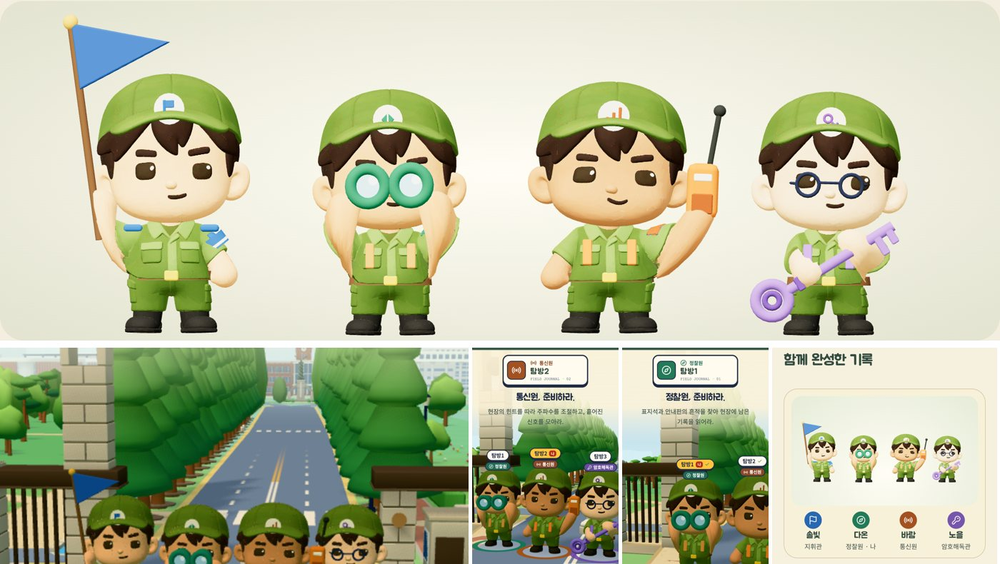

# 보직별 캐릭터 특징 · 2026-10-26

hh가 보내 준 참고 그림(점토 질감의 장병 넷이 각자 소품을 든 모습)처럼, 네 보직이 소품과 자세만 봐도 구분되게 했다. 기존 C02 장병 모형과 걷기·서기 동작은 그대로 쓰고, 소품은 지금처럼 기본 도형을 구워 붙였다. 새 3D 파일이나 블렌더·힉스필드 생성물은 쓰지 않았다(비용 없음, 모바일 용량 그대로).

| 보직 | 손에 든 소품과 자세 | 몸에 단 것 |
|---|---|---|
| 지휘관 | 오른손으로 파란 삼각 깃발을 높이 든다 | 왼팔 파란 완장, 어깨 견장 |
| 정찰원 | 두 손으로 큰 초록 쌍안경을 눈에 댄다 | 황토색 멜빵과 작은 배낭 |
| 통신원 | 왼손으로 주황 무전기를 귀에 댄다 | 등 무전기, 주황 멜빵 |
| 암호해독관 | 두 손으로 큰 보라 열쇠를 비스듬히 든다 | 보라 멜빵 (안경은 사람마다 정해지는 기존 규칙 유지) |

모든 장병에 갈색 허리띠와 노란 버클을 더했다.

## 만든 방법

- `web/components/soldier-props.ts`: 소품마다 손잡이 위치를 적고, 매 장면 동작을 튼 뒤 두 마디 팔 뻗기(IK)로 손을 손잡이에 댄다. 이 모형은 팔이 짧아서 소품을 쥔 팔만 위팔을 1.32배 고르게 키운다. 동작 믹서가 값이 바뀔 때만 다시 쓰기 때문에, 처음 크기를 기억했다가 매번 그 크기에서 새로 정한다(곱하기가 쌓이면 팔이 끝없이 커진다).
- 보직 공개 때 소품이 튀어나오는 동안 팔도 같은 속도로 따라 올라간다.
- **추모 장면에서는 소품을 내려놓는다.** 묵념 장면(`gather-stage.tsx`)과 추모 거점으로 가는 길·조용한 구역(`field-3d.tsx`)에서는 손에 든 깃발·쌍안경·무전기·열쇠를 숨기고 팔을 편히 둔다. 완장·멜빵 같은 몸에 단 것은 남긴다.

## 확인

- 디자인 검토 화면(`/design-review`), 첫 화면, 대기실 보직 공개, 이동, 묵념, 결과 화면에서 실제로 그려 확인했다.
- Vitest 40개 파일 361개, TypeScript 검사, Chrome 시험 5개(협동 탐방, 좁은 화면 2개, 안내·음량 설정, 전체 코스) 통과.
- 첫 화면(장병 넷)의 스크립트 시간은 초당 약 51ms에서 58ms로 늘었다(헤드리스 Chrome 측정). 이동 화면은 차이가 측정 오차 안이었다. 실제 휴대폰의 프레임은 아직 재지 않았다.

