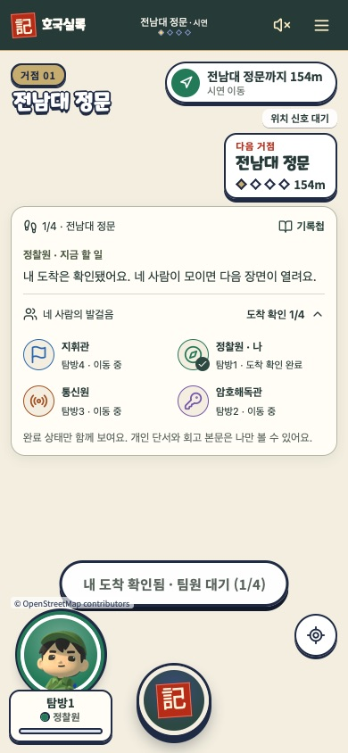
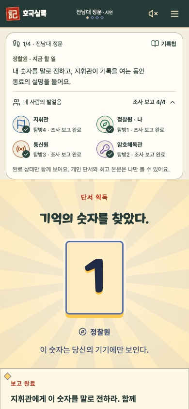
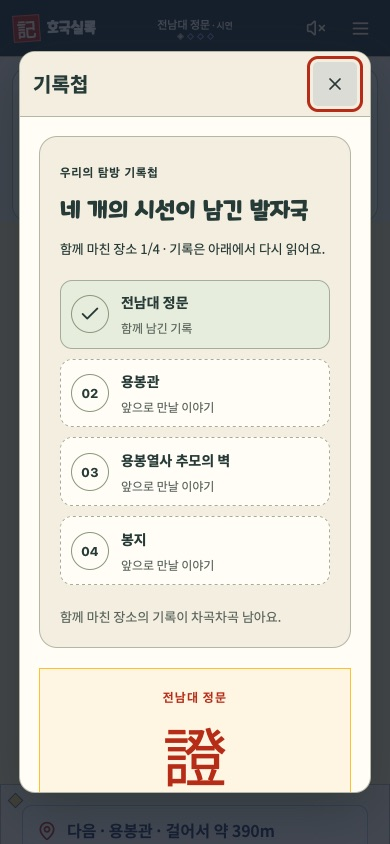

# 협동 탐방 UX 개선 · 2026-10-15

사용자 우선순위: **전체 UX와 협동 플레이**. 이전 후보 `d0aabe6`에서 `codex/coop-expedition-20261015`로 분기했다.

## REA 실행 결과와 분석 범위

요청한 `npx rea-agents setup`을 공식 npm의 `rea-agents@6.5.0`으로 고정하고 `--client codex` 범위에서 실행했다. 읽기 전용 계획 확인 뒤 실제 설치가 `ready`로 완료됐다. Codex 설정은 설치기가 백업했고, 기존 설정을 유지하면서 REA 항목과 공식 스킬을 추가했다. 기본 Node 22.14 대신 이미 설치된 Node 24.19를 REA 전용 PATH에 지정했다. 이후 `doctor --client codex`는 등록 상태 정상, 스킬 일치를 확인했다. 요약은 [설치 기록](REA_SETUP_2026-10-15.json)에 있다.

현재 대화에는 새 MCP 도구가 아직 연결되지 않았다. Codex 재시작/재연결 후 도구가 나타나야 한다. 네이티브 분석 엔진과 두 게임의 앱 파일·녹화 자료는 제공되지 않았다. **동물의 숲이나 포켓몬 GO의 내부 코드·바이너리를 REA로 분석했다고 주장하지 않는다.** 아래 비교는 공식 공개 자료에 근거한 UX 분석이며, 호국실록의 코드는 직접 확인했다.

## 근거에서 구현까지

| 확인한 공식 동작 | 호국실록에 대한 설계 판단 | 이번 구현 |
|---|---|---|
| [Pokémon GO Party Play](https://pokemongo.com/partyplay)는 최대 4인의 공동 과제와 파티 진행 상황을 제공한다. | 개인 역할과 팀 목표를 같은 화면에 연결하면 협동 맥락을 놓치지 않게 할 수 있다. 효과 검증 전의 가설이다. | 현재 장소·내 역할·지금 할 일과 펼쳐 보는 4인 상태판. |
| [Routes 도움말](https://niantic.helpshift.com/hc/en/6-pokemon-go/faq/4175-what-are-routes/)은 경로 시작과 이동 진척·일시정지 상태를 설명한다. | 이동, 내 도착, 모두의 도착을 분리해 대기 이유를 알려 준다. | 실제 서버 도착 마스크로 1/4 등 표시. 모의 도착과 GPS 구분은 유지한다. |
| [Nintendo 탐색 소개](https://animalcrossing.nintendo.com/new-horizons/explore/)는 자신의 속도로 탐색하고 발견·목표를 NookPhone에 정리하는 흐름을 보여 준다. | 사초를 탐방의 누적 기록으로 읽게 한다. | 네 장소의 기록첩. 서버가 확인한 완료만 표시하며 향후 장소를 자동 획득하지 않는다. |
| [Party Play](https://pokemongo.com/partyplay)는 함께한 활동의 결과를 정리한다. | 마지막에 공동 문장과 각자의 기여를 다시 읽을 수 있게 한다. | 기존 결과 화면에 탐방 기록첩을 연결한다. 공동 문장과 개인 회고의 공개 범위는 유지한다. |

공식 설명은 인터페이스 동작의 근거이며 사용자 만족도나 학습 효과를 입증하는 자료로 사용하지 않는다. 게임의 이미지·음악·모델·코드를 복제하지 않았다. 첨부 캐릭터 이미지의 둥근 비율과 역할 소품은 후속 아트 방향의 참고이며, 이번 변경은 선택하신 협동 UX에 집중했다.

## 동작

- **이동:** 내 도착 확인 여부와 팀 집결 수를 구분한다. 상태판에는 역할·호출명·완료 상태만 표시한다.
- **조사:** 열린 단서 조사, 보고 준비, 선행 역할 대기, 숫자 구두 전달, 지휘관 자물쇠 확인으로 다음 행동을 바꾼다.
- **추모:** 헌화와 조용한 기다림을 안내한다. 순위·시간 압박·새 보상 시스템을 추가하지 않는다.
- **회고:** 내 회고 저장 → 전원 저장 → 지휘관 공동 문장 → 개인별 동의 순서로 안내한다. 문장/회고 수정으로 서버 동의가 초기화되면 안내도 최신 상태를 따른다.
- **기록첩:** 실제 코스 목록과 획득·결과 데이터를 사용한다. 두 거점 코스에도 없는 장소를 만들어 표시하지 않는다.
- **좁은 화면:** 상태판을 펼쳐도 개인 숫자와 제출 동작이 잘리지 않도록 본문을 스크롤한다.

## 확인

- 단위 시험: 38개 파일, 354개 시험 통과.
- 초기 Chrome: 새 협동 UX, 4인 용봉관 UI 풀이, 추모 이후 공동 기록·결과 복구 모두 통과.
- 캡처에서 발견한 펼침 시 숫자 잘림을 수정하고 좌표 기반 회귀 검사를 추가했다.
- 최종 프로덕션 빌드와 TypeScript 검사 통과. Chrome의 수정된 숫자 노출·용봉관 UI 풀이 재검사 통과. WebKit의 새 협동 UX·기록첩·접근성 검사와 4인 헌화·회고·공동 기록·결과 복구까지 통과. 전체 코스 시험의 정문·용봉관 준비는 API로 진행하고, 추모 이후는 UI로 조작했다.
- 자동 시험은 로컬 합성 데이터와 모의 도착을 사용한다. 실제 휴대폰 4대의 야외 GPS·오디오·재접속 시험은 별도다.

## 체험

맥 미리보기: http://localhost:3020/?mockup=1

같은 와이파이 휴대폰: http://192.168.0.53:3020 (맥 주소가 바뀌면 변경 필요)

전체 코스는 **작전 시작 → 4명 합류**로 체험한다. 기존 ‘혼자 데모’의 두 거점 범위는 그대로다. 진행 화면에서 ‘네 사람의 발걸음’을 펼치거나 ‘기록첩’을 누르면 새 UX를 확인할 수 있다.

이번 결과는 로컬 작업 브랜치에 보존한다. 팀 사이트 반영과 김동욱 검토·머지는 별도다. 장기 수집 보상이나 점수·랭킹 정책은 이번 변경에서 새로 확정하지 않았다.

## 화면 캡처

로컬 합성 시연이며 실제 참여자의 기록이 아니다.

