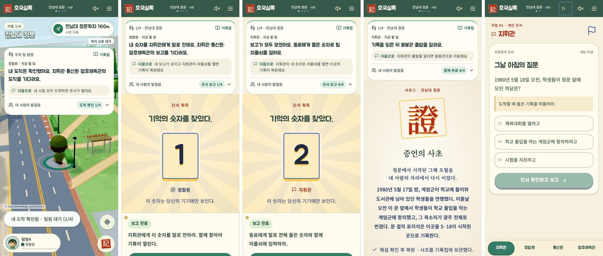

# 협동 안내: 기다리는 이유와 다음 조건 · 2026-10-26

`f98fc37` 위에서 이어 작업했다. 4인 방(4거점)과 혼자 데모(2거점)를 로컬 합성 데이터·모의 도착으로 각각 돌려 보고 고쳤다.

## 찾은 문제

- 내가 할 일을 끝낸 뒤 "모두를 기다려요"만 보여, 누구를 왜 기다리는지 알 수 없었다.
- 다음 장면으로 넘어가는 조건이 화면마다 흩어져 있었다(도착 버튼, 보고 완료 문구 등).
- 이동 화면에서 협동 안내의 첫 줄이 위의 거점 이름·순번과 겹쳐 같은 정보를 두 번 보였다.
- 혼자 데모의 보직 전환 줄이 예전 파랑 테두리·사각 모양으로 남아 크림·민트 화면과 어긋났다.

## 바꾼 것

- `lib/coop-guide.ts`: 내 몫이 끝나면 아직 끝내지 않은 동료의 **보직 이름**으로 기다리는 이유를 말한다(예: "지휘관·통신원·암호해독관의 보고를 기다려요"). 서버가 이미 내려 준 완료 마스크만 읽고, 동료의 단서·숫자·회고 본문은 읽지 않는다. 보고가 모두 모이면 숫자 보유자에게 "이제 지휘관이 자물쇠를 열 차례예요"라고 알린다.
- 같은 파일에 `until`(다음으로 넘어가는 조건)을 추가했다. 도착·조사·헌화·회고·동의·완료 단계마다 한 줄로 정한다.
- `components/coop-compass.tsx`: 할 일 아래 "다음으로" 줄을 표시한다. 이동 화면(compact)에서는 첫 줄을 "우리 팀 탐방"으로 바꿔 거점 이름 중복을 없앴다. 추모 단계는 기존 차분한 색을 따른다.
- `app/game-theme.css`: 혼자 데모의 보직 전환을 둥근 민트 칩으로 맞췄다.

## 확인

- Vitest 39개 파일, 355개 시험 통과(협동 안내 시험에 대기 이유·다음 조건 확인 추가). TypeScript 검사 통과.
- Chrome: 기존 협동 탐방 시험(4세션, axe WCAG 2 A/AA 포함)과 좁은 화면 시험 3개 통과.
- 실제 폰·GPS·스피커 확인은 하지 않았다.

## 배경음 메모(변경 없음)

음원 측정(EBU R128 통합 음량): 대기·이동 약 −18 LUFS, 미션 −22 LUFS에 재생 배율 0.3을 곱해 실제로는 약 −33 LUFS다. 이동에서 미션으로 넘어갈 때 13dB 가까이 작아진다. 2026-10-11 "미션 곡이 거슬린다"는 결정으로 줄인 값이라 그대로 두었다. 실제 폰 스피커로 들어 보고 미션 배율(`TRACK_GAIN["04"]`)을 0.4~0.45로 올릴지 정한다.

