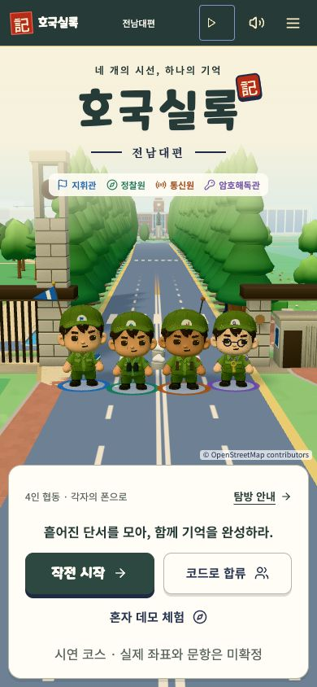
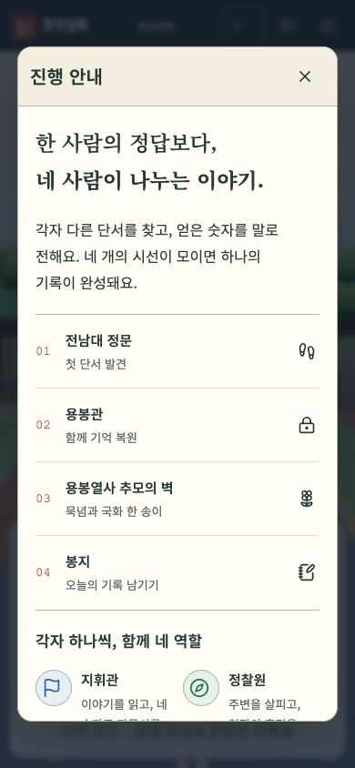
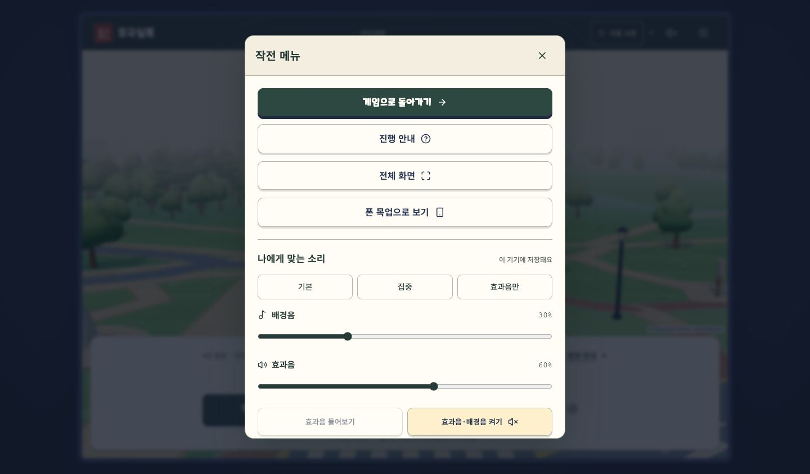

# 호국실록 최종 프로토타입 후보 · 2026-10-15

## 기준과 방향

팀 main `0598e73`에서 `codex/final-prototype-20261015`를 만들고, 기존 로컬 `feat/memorial-tribute`의 `bd88f78`까지 통합했다. 원본은 `army-main`, 검토용 작업 폴더는 `army-final`이다.

사용자는 현재 화면을 진단한 뒤 어울리는 방향을 제안해 달라고 했다. 이 후보는 **장난감 같은 사람형 캐릭터 + 차분한 기록 여행**을 제안한다. 기존 C02, 실제 캠퍼스 지도와 코스 서사를 이어 쓴다.

| 관찰한 문제 | 적용한 개선 | 검토할 지점 |
| --- | --- | --- |
| 네 인물의 역할이 작은 장비에 의존함 | 모자에 깃발·나침반·신호·열쇠 배지, 이름과 아이콘을 함께 표시 | 더 큰 캐릭터 재설계가 필요한지 |
| 긴 세로 화면에서 좌우 인물이 잘릴 수 있음 | 화면 폭으로도 네 인물의 전체 너비를 계산, 카메라 이동 축소 | 실제 휴대폰에서 인물 크기·움직임 |
| 시작하기 전에 협동 방식과 전체 동선이 안 보임 | 시작 화면의 탐방 안내, 네 거점과 네 역할, 구두 전달 규칙 | 첫 이용자가 설명 없이 이해하는지 |
| 전체 소리의 켜기/끄기만 가능 | 배경음과 효과음 분리, 기본·집중·효과음만 프리셋, 저장·복구 | 실제 스피커에서 편안한 음량인지 |
| 강한 노랑 테두리·짙은 그림자가 기록 장면과 경쟁함 | 종이·짙은 녹색 중심, 단순한 테두리, 안내 본문 스크롤·고정 닫기 | 기존 게임 분위기를 충분히 유지하는지 |

## 음악

기존 캠퍼스 음원 9곡을 사용한다. **새 곡을 작곡하거나 기존 오디오 파일을 편집한 작업은 아니다.** 대기·이동·미션·회고의 재생 음량을 조정하고, 사용자 음량과 장면별 감쇠를 곱해 적용한다. 역할 공개·사초·결과 신호는 배경음과 별도 효과음 버스로 재생하므로 ‘효과음만’에서도 들을 수 있다. 추모 무음 규칙은 사용자 설정보다 우선한다.

## 실행과 체험 범위

```sh
cd '/Users/lxxhxxnhxx/Desktop/군학연계 프로젝트/army-prototype/army-final/web'
npm run start -- --port 3020
```

`.env.local`에 로컬 모드와 `full-course-v1` 시연 코스가 준비되어 있다. 비밀 설정과 `.demo-data`는 Git 제외 대상이다. 서버가 멈췄을 때 위 명령으로 다시 켠다. 코드를 수정하면 먼저 `npm run build`가 필요하다.

- 맥: http://localhost:3020
- 같은 와이파이 휴대폰: http://192.168.0.53:3020 (맥 주소가 바뀌면 변경 필요)
- **작전 시작 + 코드 합류:** 네 세션으로 정문 → 용봉관 → 추모의 벽 → 봉지·결과. 로컬에서는 모의 도착으로 진행한다.
- **혼자 데모 체험:** 기존 두 거점 미리 보기. 전체 4인 코스와는 범위가 다르다.
- 상단 메뉴 → 나에게 맞는 소리에서 음량과 프리셋을 바꾼다.

## 검증

- 프로덕션 빌드 및 TypeScript 검사 통과.
- Vitest 37개 파일, 351개 시험 통과. 새 음량·화면 폭 시험 4개 포함.
- Chrome: 320·390·768·1440px 안내/음량 설정, 저장·복구, 키보드 조절, axe WCAG 2 A/AA 검사 통과. 실제 3D 홈 화면 로딩도 확인.
- Chrome·WebKit: 독립된 네 세션으로 용봉관 화면의 문제 풀이 통과. 다른 역할의 정답 노출도 검사했다.
- Chrome·WebKit: 추모의 벽 헌화 → 봉지 개인 회고·공동 기록 → 동의 버전 갱신 → 결과·새로고침 복구 통과. 이 시험의 앞부분 정문·용봉관은 API로 진행하고, 추모 이후는 UI로 조작한다.
- WebKit: 최종 안내/음량 설정의 동일한 반응형·저장·키보드·접근성 검사 통과.
- 초기 axe 검사에서 찾은 스크롤 영역의 키보드 접근 문제는 포커스 가능한 이름 있는 영역으로 수정했다. 전체 코스 시험은 자동으로 끝나는 묵념을 처리하도록 수정했으며, 실제 화면 전환 검증은 유지했다.

자동 브라우저 시험은 합성 문항·모의 도착을 사용한다. 실제 폰의 GPS·스피커 청취 품질과 현장 동기화 지연은 검증하지 않았다. 실측 결과로 인용하지 않는다.

재현 명령(로컬 서버 실행 후):

```sh
npm test
NEXT_PUBLIC_BACKEND=local npm run build
PLAYWRIGHT_BASE_URL=http://127.0.0.1:3020 PLAYWRIGHT_CHROMIUM_CHANNEL=chrome npx playwright test --config=playwright.final.config.ts --project=chromium
PLAYWRIGHT_BASE_URL=http://127.0.0.1:3020 npx playwright test --config=playwright.final.config.ts --project=webkit
```

## 화면





## 프로젝트 종료 전 남은 확인

1. 사용자 디자인·청취 검토. 이번 조정은 후보이며 디자인 확정으로 간주하지 않는다.
2. 실제 폰 4대, iOS Safari·Android Chrome에서 스피커, GPS, 야외 가독성, 끊김·재접속 확인.
3. 현장 문항·좌표 및 점수·랭킹 미결 사항은 팀의 확정 필요. 기존 자료의 미결 표시를 완료로 바꾸지 않았다.
4. 팀 GitHub 반영은 변경 검토 후 PR → 김동욱 검토·머지 흐름으로 진행. 기존 로컬 후속 작업을 함께 통합했으므로 새 UI 변경과 앞선 변경을 나누어 리뷰해야 한다.
