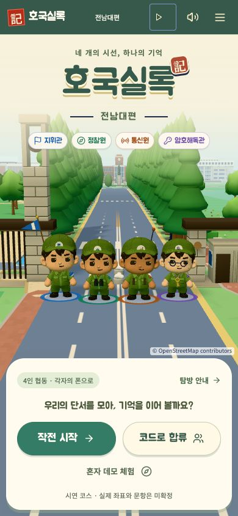
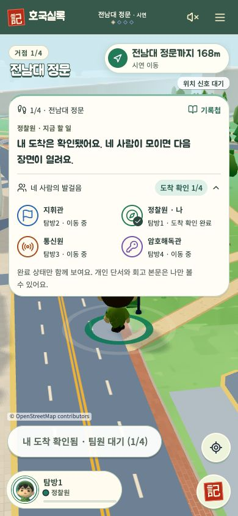
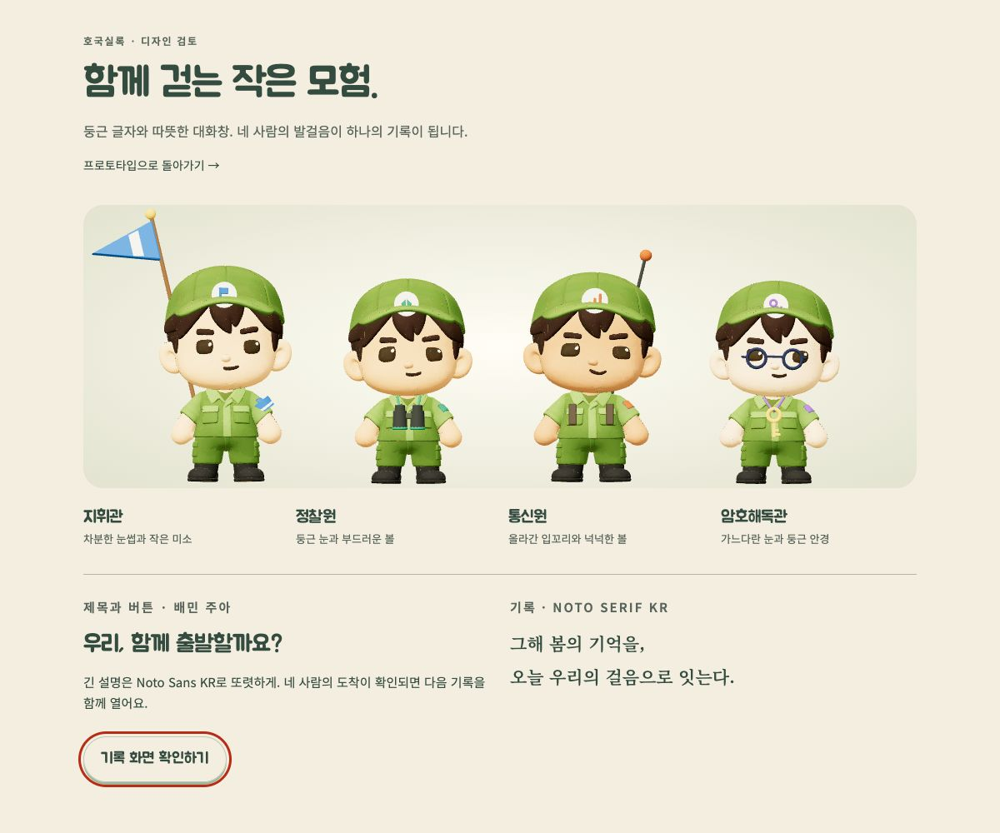

# 호국실록 게임 화면 방향 — 2026-10-15

## 디자인 계약

목적: 네 사람이 캐릭터에 애착을 갖고 캠퍼스를 탐방하면서 다음 행동과 팀 진행을 쉽게 이해한다.
첫 화면의 주 행동은 작전 시작/코드 합류, 이동 화면의 주 행동은 도착 확인이다.

- 동물의 숲 공식 게임 이미지에서 크림색의 넉넉한 곡선 패널, 자연의 민트·모래색, 캐릭터 중심 화면을 참고한다. 호국실록에는 독자적인 기록 도장과 네 보직을 사용한다.
- Pokémon GO Party Play 공식 화면에서 지도 위 목표, 네 명의 진행 상태, 명확한 주 행동을 참고한다. 이동 패널의 정보량은 늘리지 않는다.
- 제목·주 버튼·짧은 안내: 로컬 배민 주아(Jua), 400. 긴 설명·입력·작은 상태: Noto Sans KR. 사초·추모·서사: Noto Serif KR. 다른 게임의 실제 서체를 사용했다는 주장은 하지 않는다.
- 미완료/완료/선택 상태는 색만으로 구분하지 않는다. 기존 상태 문구와 체크를 보존한다. 개인 단서 노출이나 게임 규칙 변경은 없다.
- 320px부터 가로 넘침 없이, 짧은 화면에서는 콘텐츠를 스크롤한다. 지도 주 행동과 팀 안내가 겹치지 않고, 버튼 44px 이상·키보드 포커스·모션 감소를 보존한다.
- 추모 장면은 종이색·차분한 명조·낮은 채도를 유지한다. 폭죽·속도 경쟁·게임 캐릭터/상표의 복제는 추가하지 않는다.

## 확인한 원자료

- Nintendo: https://play.nintendo.com/news-tips/tips-tricks/animal-crossing-new-horizons-tips-tricks/
  - 공식 인벤토리/선택 화면(벌에 쏘인 장면): 크림색 둥근 패널, 민트 이름표, 노란 선택 강조, 여유로운 캐릭터 공간.
- Pokémon GO: https://pokemongo.com/en/partyplay
  - 공식 Party Challenges 3화면: 공동 목표 선택 → 지도/4인 상태 → 완료 수와 보상 행동.
- Jua: https://github.com/google/fonts/tree/main/ofl/jua (SIL OFL; 파일과 라이선스 로컬 보관)

## 검증

구현 후 실제 화면·폰트 로딩·좁은 폰·가로 화면·키보드·기존 협동 흐름을 확인한다.

## 반영 결과

- Pretendard의 런타임 사용을 종료하고 로컬 Jua 400 / Noto Sans KR / Noto Serif KR 세 역할로 분리했다. 브라우저에서 제목의 실제 font-family와 400 굵기, 폰트 loaded 상태를 확인했다.
- 시작 화면을 크림색 곡선 대화창, 보직별 둥근 배지, 민트색 주 행동, 가벼운 보조 체험 링크로 구성했다. 초대 문구도 대화체로 정리했다.
- 이동 화면의 목적지·도착 버튼·거리 배지를 같은 게임 표시체로 연결했다. 협동 안내의 행동 문장과 진행 수 배지를 분리하고, 기록첩의 완료 도장을 강조했다.
- 추모/기록 장면은 명조체와 낮은 채도로 분리했다. 협동 컴포넌트의 잘못된 --font-sans 참조도 --sans로 수정했다.
- /design-review에서 캐릭터와 새 서체 조합을 볼 수 있다.

### 검증 결과

- Next production build 및 빌드 내 TypeScript 검사 성공.
- Chrome: 기존 협동 진행/기록첩, 안내·음량, 기록창 포커스·스크롤, 작은 화면 임무/자물쇠/결과 테스트 4개 통과. 마지막 보조 버튼 조정 후 안내·음량/첫 화면 테스트 재통과.
- WebKit: 같은 4개 테스트 모두 통과. 각 테스트에 포함된 axe WCAG 2 A/AA 검사 통과.
- 320·390·768·1440px 및 짧은 가로 화면에서 기존 검증 실행. 실제 iPhone/현장 GPS 검증을 대신하지 않는다.
- 3020 포트의 로컬 프로덕션 미리보기에 반영. 팀 공개 사이트에는 배포하지 않았다.

