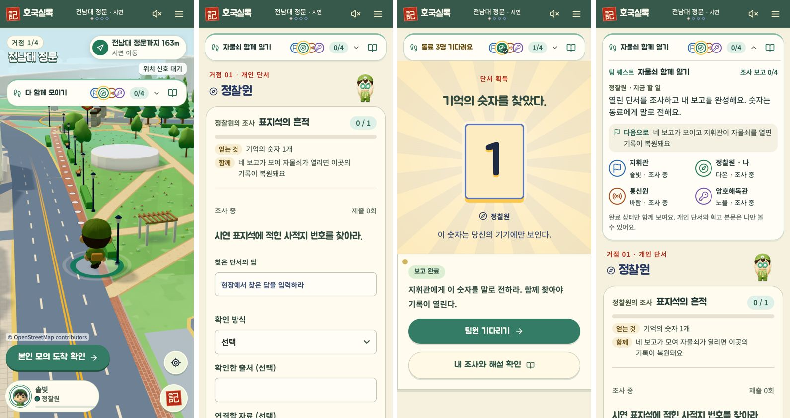
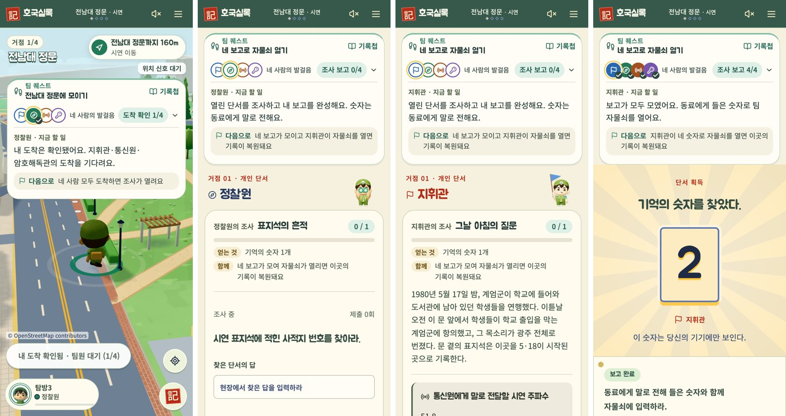

# 퀘스트 카드와 글자 5단계 · 2026-10-26

레퍼런스 비교 문서(https://claude.ai/artifact/73XfNJVFhUZta3CZ5HEkVp)에서 hh가 고른 추천 순서대로 세 가지를 반영했다. 게임 규칙·서버·정답 처리는 바꾸지 않았다.

1. **조사 퀘스트 카드** (`web/components/mission-v2.tsx`): "역할의 조사 · 조사 이름" + 진행 칩(0 / 1)과 막대 + 얻는 것("기억의 숫자 1개", 숫자가 없는 역할은 "팀에 전할 조사 결과") + 자물쇠 단계의 "함께" 줄. 숫자·정답은 보고 전에 보이지 않고 종류만 적는다. 문제 지문은 20px 한 줄로 한 화면에 하나만 크게 둔다.
2. **글자 5단계** (`web/app/game-theme.css` 끝의 `--fs-*` 토큰): 장면 제목 26 · 할 일 한 줄 20 · 본문 16 · 라벨·칩·진행 14 · 보조 13px. 지도 출처·시연 표시만 11px. 추모·기록 장면의 명조는 그대로다.
3. **팀 퀘스트 카드** (`web/components/coop-compass.tsx`, `web/lib/coop-guide.ts`의 `goal`): "팀 퀘스트 · 네 보고로 자물쇠 열기"처럼 함께 채우는 목표 하나 → 네 칸 진행(접힌 상태에서도 보임) → 내 할 일 → 다음 조건 순서.

남은 제안: 못 누르는 버튼의 이유 한 줄, 기록첩 도장 줄 상시 표시.

**같은 날 수정(hh 피드백: 위 카드가 글이 많고 너무 크다)**: 팀 퀘스트 카드를 한 줄로 접었다. 접힌 줄에는 짧은 팀 목표("자물쇠 함께 열기", "다 함께 모이기") 또는 내 몫을 마쳤을 때 "동료 3명 기다려요", 네 칸, 진행 수(1/4), 기록첩 버튼만 둔다. 누르면 지금 할 일·다음 조건·네 사람이 펼쳐지고, 펼침 상태는 그 기기에 기억한다.

## 확인

- Vitest 40개 파일 361개, TypeScript 검사 통과.
- Chrome: 협동 탐방(4세션, 접근성 검사 포함), 좁은 화면 2개, 안내·음량 설정, 전체 코스, 기본 UI 시험 통과. 320px·390px에서 가로 넘침 없음.
- 390px 실측: 화면의 상태 글자가 13·14px로 정리됐다(이전 11~12.5px). HUD의 거점 이름(23.4px)과 버튼 글자(18px)는 이번 단계표 밖에 둔다.

## 로컬 시험 환경 메모

로컬 백엔드는 모든 방을 `web/.demo-data/state.json` 한 파일에 담아 요청마다 통째로 읽고 쓴다. 이 폴더가 iCloud 바탕화면에 있어 파일이 1.8MB까지 커지자 요청이 5~40초 걸렸고 전체 코스 시험이 시간 초과로 실패했다. 지금까지 쌓인 합성 시험 방을 `state.archive-20261026.json`으로 옮겨 두고(지우지 않음) 다시 돌리니 통과했다. 오래 쓰려면 저장 위치를 iCloud 밖으로 빼는 설정이 필요하다(팀 코드 변경이라 이번에는 하지 않음).

