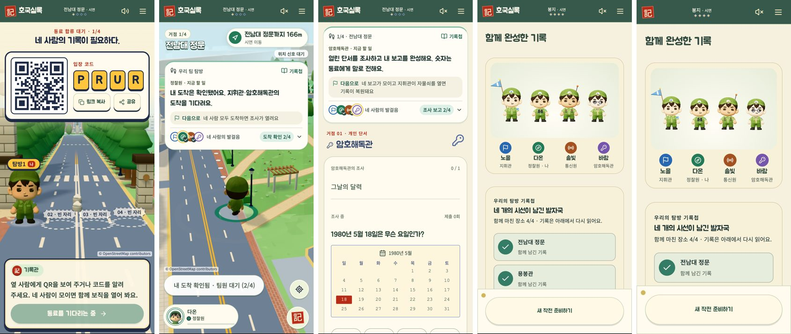

# REA로 본 공식 화면과 호국실록 비교 · 2026-10-26

hh 요청으로 `rea-agents@6.8.0`을 Claude Code에 설치하고(시스템 Node 22.14가 낮아 REA만 Node 24.22.1로 실행), REA의 `capture-browser-scenario`로 아래 화면을 390×844(2배율), 한국어 설정에서 캡처했다. 캡처마다 REA 증거 ID가 남는다.

**범위:** 공개 웹페이지와 우리 앱만 봤다. 동물의 숲·포켓몬 GO의 앱 파일이나 내부 코드는 분석하지 않았다(이 맥에 없고, 상용 게임 역분석은 하지 않는다). 공식 페이지 캡처 이미지는 저작물이라 저장소에 넣지 않았다.

## 캡처한 것

| 대상 | REA 시나리오 | 확인한 내용 |
|---|---|---|
| 포켓몬 GO 팀 플레이 소개(pokemongo.com/partyplay) | 열고 4초 대기, 화면·접근성 구조 | 호스트가 QR·숫자 코드로 팀을 만들고, 시작하면 "맵으로 돌아가고 팀원과 연결"된다. 최대 4명이 맵에서 서로의 모습을 본다. 팀 챌린지 진행을 함께 채우고, 멤버가 많을수록 팀 파워 게이지가 빨리 찬다. 팀 플레이가 끝나면 "달성한 업적과 프렌드 트레이너 모습"을 함께 보여 준다. 페이지 첫 화면은 안내 캐릭터(박사)가 말풍선으로 소식을 전한다. |
| 동물의 숲 탐험 소개(animalcrossing.nintendo.com/new-horizons/explore) | 같은 방식 | "자신의 속도로" 지내는 흐름. 부엉이 주민이 이름과 따옴표로 직접 말을 건다. 새로 찾은 생물은 도감에 바로 들어가고, NookPhone이 오늘의 목표와 모은 것을 한곳에 정리한다. 크림 바탕, 리본 제목, 물결 테두리. |
| 우리 앱: 방 만들기 | 첫 화면 → 작전 시작 → 호출명 입력 → 새 작전 만들기 → 대기실 | 대기실의 안내자는 이름표(기록관)만 있고 얼굴이 없다. 안내 문장이 "코드를 전하라", "보직을 공개한다"처럼 명령형이다. 입력 화면 제목도 "당신의 호출명을 남겨라". |
| 우리 앱: 혼자 데모(2거점) | 첫 화면 → 혼자 데모 체험 → 인트로 → 이동 → 시연 거점에 도착 | 첫 방문자에게 어두운 명조 인트로가 먼저 나온다(차분해서 유지). 도착하면 원판을 밀어 기록을 펼치는 장면이 나온다(포켓스톱과 비슷한 도착 행동, 이미 있음). |
| 우리 앱: 4인 방(4거점) | 기존 API 시험 흐름으로 4세션 진행 후 화면 캡처 | 팀 진행은 "도착 확인 1/4" 숫자로만 보이고, 누가 끝냈는지는 펼쳐야 보인다. 결과 화면은 통계 글이 위주이고 함께한 네 사람의 모습이 없다. |

## 고친 것

1. **팀 진행을 접힌 상태에서도 한눈에** (근거: 팀 플레이의 맵 위 팀원 모습·공동 게이지). 협동 안내의 "네 사람의 발걸음" 줄에 네 보직 아이콘을 늘 보여 준다. 끝낸 사람은 보직 색으로 채워지고 체크가 붙으며, 나는 노란 테두리로 구분한다. 완료 여부만 표시하고 단서·숫자는 넣지 않는다. 360px 이하에서는 글자를 낭독기 전용으로 숨기고 아이콘이 자리를 맡는다.
2. **이름 있는 안내자** (근거: 동물의 숲 주민의 직접 화법, 팀 플레이 페이지의 안내 캐릭터). 대기실의 기록관 이름표에 붉은 기록 도장(記)을 얼굴처럼 붙였다. 기록관의 안내와 입력 화면 제목을 편안한 말투로 바꿨다("코드를 알려 주세요", "함께 보직을 열어 봐요", "탐방에서 부를 호출명을 알려 주세요"). 미션 지문과 추모·기록 문장은 그대로 두었다.
3. **결과 화면의 단체 사진** (근거: 팀 플레이 종료 시 업적과 동료 모습을 함께 보여 줌). "함께 완성한 기록" 맨 위에 네 캐릭터를 한 줄로 세우고, 그 아래 호출명과 보직을 붙였다. 호출명·보직은 이미 공개 정보다. 폭죽이나 순위는 넣지 않았다.

## 확인

- Vitest 39개 파일 361개 시험, TypeScript 검사 통과.
- Chrome: 협동 탐방(4세션, 접근성 검사 포함), 좁은 화면 2개, 전체 코스(헌화 → 회고 → 공동 기록 → 결과 복구) 시험 4개 통과.
- REA로 바뀐 대기실을 다시 캡처해 새 문장과 안내자 표시를 확인했다.
- 실제 폰·GPS·스피커 확인은 하지 않았다.

## 남은 후보(이번에 하지 않음)

- 미션 지문과 상태 문장 전체의 말투 정리("~하라"와 "~해요"가 섞임). 기록·추모 장면의 문체와 함께 정해야 한다.
- 캐릭터 외형 교체는 hh의 참고 사진을 받은 뒤 진행한다.

