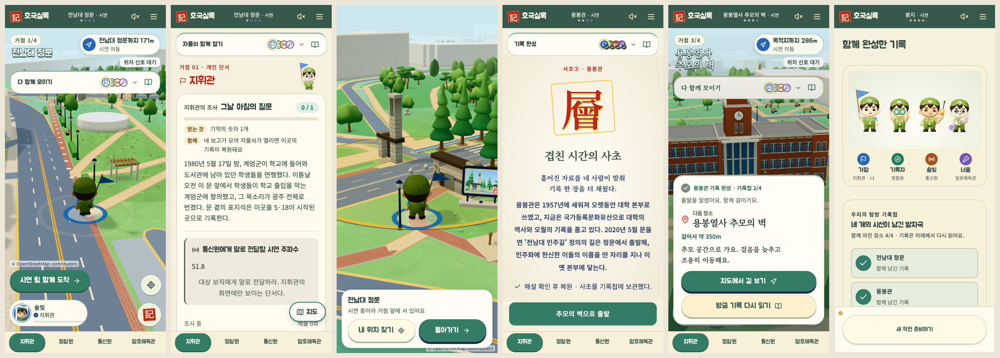
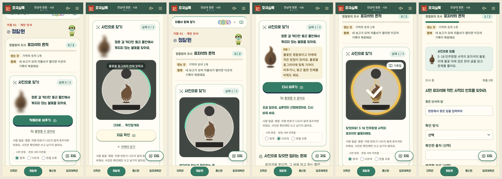

# 혼자 시연 네 곳 잇기 · 문제 중 지도 · 정찰원 사진으로 찾기 (2026-10-27)

hh 요청 두 가지와 정찰원 정문 미션 재설계를 한 번에 정리한다. 서버 게임 규칙(엔진)과 팀원 파일은 고치지 않았다.

## 1. 혼자 데모 체험이 네 곳 끝까지 간다

- 원인: '혼자 데모 체험'은 예전 두 곳(정문·용봉관) 전용 엔진으로 따로 돌았다. 4인 방은 이미 네 곳 코스였다.
- 바꾼 것: 혼자 데모 체험은 4인 방과 같은 네 곳 코스(정문 → 용봉관 → 추모의 벽 → 봉지)로 연다.
  한 기기가 네 자리(본인 + 시연 동료 솔빛·너울·가람)를 맡고, 아래 '체험 보직' 줄에서 보직을 바꿔 가며 각자의 화면으로 진행한다.
  - 새 로컬 전용 통로 `web/app/api/game/solo/route.ts`: 자리마다 이 기기 세션에서 만든 별도 세션으로 합류·준비·출발한다.
    엔진은 그대로라 네 명이 실제로 합류한 방이고, 보직을 맞바꾸지 않는다. 자리 세션으로는 새 방을 만들거나 다른 방에 합류할 수 없다.
  - 모의 도착('시연 팀 함께 도착')을 누르면 시연 동료도 함께 도착한다. 문제·헌화·회고·동의는 보직을 바꿔 각자 한다.
  - 네 곳 시연 코스가 없는 서버면 예전 두 곳 혼자 시연으로 연다. 발표용 '자동 시연'과 '시연 장면 고르기'는 아직 예전 두 곳 그대로다.
- 기록(사초) 화면의 지휘관 출발 단추를 화면 아래에 붙였다. 전에는 스크롤 아래에 숨어 '용봉관에서 끝난 것'처럼 보였다.

## 2. 모든 문제 화면에서 지도로 갔다 돌아오기

- 정문·용봉관·추모의 벽(헌화)·봉지(회고) 문제 화면 오른쪽 아래에 '지도' 단추를 띄운다. 기본은 문제 화면 그대로다.
- 누르면 이동 화면과 같은 캠퍼스 3D 지도(OpenStreetMap 자료)에 내 위치와 지금 거점이 보이고, '돌아가기'로 문제로 돌아온다.
  GPS가 있으면 실제 위치를, 시연이면 거점 앞에 선 내 장병을 보여 준다. 팀 줄의 작은 지도 아이콘은 이 단추로 옮겼다.

## 3. 정찰원 정문 '사진으로 찾기' (hh 답 1~7 반영)

레퍼런스: 아이폰 '빠른 시작'(새 아이폰으로 데이터 옮기기)의 둥근 카메라 조준(hh 2026-10-27).

흐름: 흐린 불꽃 실루엣과 수수께끼 → '카메라로 비추기' → 밖은 어둡고 가운데 동그라미만 밝은 조준 화면에서 불꽃을 동그라미 안에 맞춘다
→ 흔들림 없이 잠깐(1.2초) 멈추면 테두리가 차오르고 알아서 찍어 확인한다('지금 확인'으로 바로 찍을 수도 있다)
→ 맞으면 동그라미가 금빛으로 닫히며 체크가 그려지고 '찾음' 도장이 기록첩으로 들어간다(약 2.5초, 폭죽·큰 소리 없음). 머리의 정찰원은 쌍안경을 내리고 끄덕인다
→ 표지석 글을 읽고 푸는 짧은 문제(게임 서버의 기존 정찰원 문제, 서버 채점)가 열린다.
멈춤 판정은 폰 안에서 아주 작은 화면(40×30)의 밝기 변화만 보고, 그 화면은 남기지 않는다.

- 틀리면: 1번 → 실루엣이 선명해지고 힌트 1(청동 불꽃·받침, 둥근 돌판 전체도 인정), 2번 → 힌트 2(위치), 3번 → '사진 검증 실패 후 통과'.
  실패 후 통과는 사진 단계만 넘어가고 성공으로 적지 않는다. 문제·보고·자물쇠는 그대로 남는다.
- '촬영할 수 없어요'(카메라 오류·촬영 금지)도 실패 1번으로 센다(팀원 PR #17 규칙).
- 판정은 아직 팀원 PR #17의 모의 판정기다. 카드 아래 '시연 판정(맞게/다르게/연결 오류)'으로 고른다. 개발 서버에서만 보이고 운영 빌드에는 나오지 않는다.
- 사진은 판정기에 넘긴 뒤 남기지 않는다. 기준 사진·임계값·정답은 FE에 없다(`web/lib/scout-photo/sites.ts`에는 화면 글과 그림 모양만).
- 장소별 설정은 `SCOUT_SCAN_SITES` 데이터로 둔다. 용봉관은 대상이 정해지면 같은 모양으로 더한다.
- 위치 힌트 문구는 hh 사진·영상 기준이라 `confirmed: false`다. 현장 답사로 다시 확인한다.
- 개발 서버의 게임 화면(`/`, `/j/:code`)만 카메라 권한을 열었다(`next.config.ts`, 운영 빌드는 그대로 카메라 막음).

## 시험

- 새 e2e `web/tests/e2e/solo-route.spec.ts`(3개): 혼자 시연 네 곳 완주(보직 전환·지도·출발 단추·헌화·공동 기록·결과),
  사진으로 찾기(틀림 → 힌트 → 맞음 → 문제 열림), 3번 실패 후 통과, 자리 세션 권한. 가짜 카메라로 찍는다.
- 예전 두 곳 혼자 시연을 다루는 시험은 localStorage `hoguk:demo-course=v1`, 사진으로 찾기를 다루지 않는 4인 시험은 `hoguk:photo-gate=off` 스위치를 쓴다.
- 결과는 이 문서를 올린 PR 설명에 적는다.

## 남은 일

- 판정 서버 연결: 김종연 님과 사진 단계 계약(엔진의 사진 단계·실패 횟수 저장, photo-verify 호출) 맞추기. 지금은 실패 횟수가 이 기기에만 남는다.
- 용봉관 사진 대상 정하기, 3D 불꽃 연출, 혼자 시연 자동 시연(네 곳) 여부.
- 폰 실제 카메라·GPS 현장 시험(https 개발 서버).
