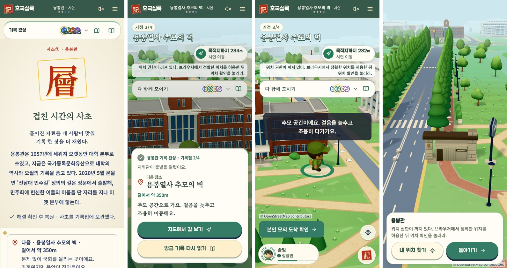

# 장면 전환과 지도 보기 · 2026-10-26

hh 피드백: 용봉관을 마치고 추모의 벽으로 갈 때 화면이 뚝 끊기고, 문제를 푸는 중에는 내 위치를 볼 수 없다.

## 실제로 본 흐름 (4인 방, 나레이션·도착 화면 켬, 정찰원 화면)

보고 완료 화면 → (지휘관이 자물쇠를 염) 어두운 나레이션 → 사초 기록 화면 → (지휘관이 출발을 누름) 약 1초 뒤 **예고 없이 지도로 바뀜**. 다른 사람이 기록을 읽는 중이어도 바로 넘어갔고, 다음 장소 안내 카드는 기록 화면 아래쪽에 있어 스크롤해야 보였다. 정문→용봉관, 추모의 벽→봉지 출발도 같은 구조다.

## 바꾼 것

- **출발 연결 카드** (`web/components/depart-card.tsx`): 기록 화면에서 다음 거점 이동으로 넘어가는 순간 지도 위에 한 번 뜬다. "용봉관 기록 완성 · 기록첩 2/4 → 지휘관이 출발을 알렸어요 → 다음 장소 · 걸어서 약 350m → 한 줄 안내 → [지도에서 길 보기] [방금 기록 다시 읽기]". 추모 장소로 갈 때는 명조·낮은 채도와 "걸음을 늦추고 조용히 이동해요". 4인 방(v2)에만 나온다.
- **지도에서 내 위치 보기**: 팀 퀘스트 줄에 지도 버튼을 두었다(조사·보고·자물쇠·기다림·기록 화면). 누르면 전체 화면 지도와 "내 위치에서 약 Nm", [내 위치 찾기] [돌아가기]. 위치 신호가 없으면 그 이유를 그대로 보여 준다. 이동 화면에는 지도가 이미 있어 버튼을 두지 않는다.
- 팀 퀘스트 줄이 좁아 목표 글이 잘리던 것을 고쳤다: 앞 아이콘을 빼고, 진행 수는 네 칸이 보여 주므로 낭독기용으로만 남겼다.

## 더 찾은 어색한 곳 (이번에는 고치지 않음)

1. 기록 화면에서 지휘관의 출발 버튼이 긴 기록 글 아래에 있어 스크롤해야 보인다.
2. 보고를 마친 뒤 "팀원 기다리기"가 주 버튼이다(할 일이 아니라 상태).
3. 추모 구역 안내("추모 공간이에요…")가 지도 가운데 캐릭터 위를 덮는다.
4. 혼자 데모(2거점)는 옛 흐름이라 출발 카드·지도 버튼이 없다.

## 확인

Vitest 361개, Chrome 시험 6개(협동 탐방·좁은 화면·안내·전체 코스·기본 UI) 통과. 실제 폰 GPS로 지도 위치 표시는 아직 확인하지 않았다.

