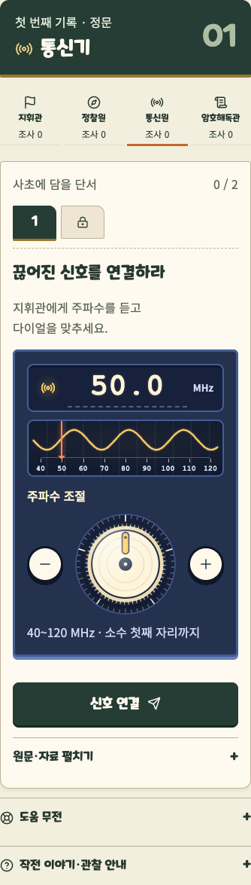
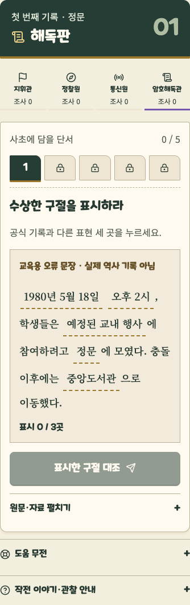
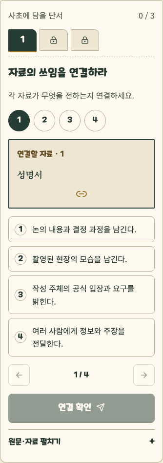

# MINO 대본에서 협동 탐방 게임으로

2026-10-11. 이번 작업 시작점: `5e0aa0c`. 장소·보직·서버 완료 조건·25개 조사 단계·추모의 벽을 유지하면서, 화면 정보량과 조작 방식을 바꾼다. 원본 답과 비공개 자료는 이 문서에 싣지 않는다.

## 원문 분석

`GPS_MINO_1st_scenario_current.md`는 966줄, 약 3만 자다. 플레이어 대사뿐 아니라 진행 조건, 운영 예외, 진행자용 설명과 답안을 함께 담은 제작 대본이다. 이를 플레이 화면에 누적해서 표시하면 ‘상황을 이해한 뒤 행동’보다 ‘긴 지문을 읽고 답안을 제출’하는 경험이 강해진다.

학습 목표는 네 가지로 읽었다: 현장과 설명 대조, 동료에게 정확히 전달, 오류와 출처의 한계 판단, 자신의 말로 회고. 화면 글자를 모두 없애거나 정답 선택만 빠르게 만드는 방식은 이 목표를 약화시킨다. 보존해야 할 내용은 실제 판단 대상인 문장·선택지·근거·본인 기록이고, 줄일 것은 반복 설명과 아직 필요하지 않은 통제 UI다.

- 기존 통신원 첫 화면: 보직 소개, 장면 대사, 단계 제목, 제출 통계, 설명, 다이얼, 보고 안내, 해설 안내가 함께 표시된다.
- 기존 지휘관: 아직 동료를 기다리는데 문제 목록·보고 버튼·힌트 네 세트·해설 확인이 모두 등장한다.
- 기존 기록 문항: 여러 필드를 동시에 보여주어 관찰보다 작성 부담이 먼저 보인다.
- 현재 첫 화면의 글자 수는 공백을 제외하고 지휘관 544, 정찰원 307, 통신원 330, 암호해독관 349자였다. 네 독립 context의 새 방·정문 도착 직후·390×844px·나레이션 닫힘·본문 기본 접힘 상태에서 `.mission-stage.innerText`로 측정했다. 실제 단서·답안 문자열은 출력하지 않았다.

## 설계 근거와 적용 판단

[Plass·Homer·Kinzer의 게임 기반 학습 연구](https://www.tandfonline.com/doi/abs/10.1080/00461520.2015.1122533)는 학습 내용에 대한 인지·행동·감정·사회적 참여를 함께 다룬다. 여기서는 학습할 행동과 게임 조작을 연결하는 기준으로 활용했다. 점수 장식만으로 교육 효과가 입증된다고 해석하지 않는다.

[Mobius Digital의 탐험 설계 기록](https://www.mobiusdigitalgames.com/news/the-intentionality-of-wandering)은 호기심이 다음 선택을 이끄는 단서와 경로를 설명한다. 이 프로젝트에서는 ‘다음 단서를 얻으려면 어느 동료에게 무엇을 물을까’를 드러내는 데 적용했다. 해당 게임의 세계·자산·레이아웃은 복제하지 않는다.

기존 다이얼·역할 색·메이플스토리 글꼴·종이 사초를 화면 참고로 삼았다. 다이얼의 물성, 사초의 수집, 보직 간 정보 차이를 중심으로 전개한다. 새 사진이나 역사 장면을 생성하지 않는다.

## 플레이 규칙

**짧은 상황 → 도구 조작 → 서버 확인 → 기록 조각 → 말로 보고 → 다음 단서.**

| 원문에서 하는 일 | 새 조작 | 남기는 학습 행동 |
|---|---|---|
| 지휘관의 보고 진위 판정 | 보고 한 장씩 넘기고 참·거짓 도장 | 한 주장과 근거에 집중, 제출 전 재판단 |
| 사건 순서 | 사건 카드를 시간선에 올리고 이동 | 사건 사이 선후 관계 구성 |
| 정찰원의 형태 관찰 | 관찰 계수기, 탐색 수첩 | 화면 밖에서 관찰하고 직접 값 입력 |
| 통신 복원 | 기존 물리 다이얼 + 짧은 목표 | 동료에게 숫자를 듣고 정확히 전달 |
| 암호해독관 오류 탐지 | 보고서 문장 속 구절을 직접 표시 | 원문을 대조하고 의심 지점 식별 |
| 자료 기능·출처·근거 연결 | 자료 카드와 연결 포트 | 자료가 말해주는 범위 비교 |
| 관찰·출처·한계 기록 | 한 항목씩 쓰는 수첩 | 본 것·읽은 것·모르는 것 분리 |
| 공동 문장 | 빈칸에 낱말 조각 놓기 | 팀 경험에 맞는 표현 선택과 이유 설명 |

원래 25개 단계와 기록 항목은 삭제하지 않았다. 객관식/서술형 판정이 모두 새로운 게임 규칙으로 바뀐 것은 아니다. 핵심 변화는 역할 도구, 문장 표시·카드 연결·도장·계수·낱말 조합, 단계별 정보 공개다. 새 문항·사진·가짜 증거를 추가하지 않았다.

## 화면 계약

- 첫 화면은 역할 도구, 네 사람의 공개 보고 상태, 지금 가능한 행동만 보여준다.
- 지휘관의 개인 신호는 ‘통신원에게 전할 신호’ 봉투를 직접 열어 확인한다. 다른 역할로 전송하지 않는다.
- 잠긴 단서는 어떤 동료의 조사를 기다리는지 보여준다. 이미 완료했다는 가짜 수신 연출은 없다.
- 대본 원문·공식 링크·본인 기록·도움 무전은 같은 화면에서 펼친다. 통신원의 공유 허용 자료만 암호해독관의 받은 자료 묶음에 표시한다.
- 카드 선택 색과 도장은 본인의 선택이며 정오 판정을 의미하지 않는다. 완성 도장은 서버가 완료를 반환한 뒤에만 표시한다.
- 한 묶음의 모든 필수 값을 채우기 전 제출할 수 없다. 숨긴 수첩 페이지의 미입력도 검사한다.
- 단서 전환 중 미제출 초안은 유지한다. 새로고침·보직 전환 후 미제출 초안 복구는 보장하지 않는다.
- 행동 버튼은 ‘문제 제출’ 대신 실제 행동을 적는다. 미완료 상태에서 결과 보고와 자물쇠를 먼저 권하지 않는다.
- 기본 나레이션은 짧은 장면 단위로 각색한다. 원본 MINO 문구와 기존 코스 나레이션은 삭제하지 않는다.
- 추모는 기존 구현. 음원·3D 지도·기존 다섯 코스·비공개 정답 저장과 판정은 변경하지 않는다.
- 본문 16px 이상, 버튼 최소 44px, 320~430px·글자 130%, 한글 어절 줄바꿈, 키보드 조작, 동작 줄이기를 따른다.

## 검증과 남은 확인

UI 조작과 완주 검증은 재미나 학습 효과의 실험적 입증을 대신하지 않는다. 현장 사진 권리, 안내 표기·관람 가능 여부·GPS, 실제 휴대전화 4대 시험은 별도 확인이 필요하다.

| 실행한 검사 | 최종 결과 |
|---|---|
| `npx tsc --noEmit -p .` | 통과 |
| `npx vitest run` | 41개 파일·369개 시험 통과 |
| `npm run build` | 통과 |
| `PLAYWRIGHT_STORY_B_URL=http://127.0.0.1:3014 npx playwright test --config playwright.story-b.config.ts` | Chrome·WebKit 합계 8개 통과, 3.3분 |
| `git diff --check` | 통과 |

처음 빌드에서는 새 단위 시험의 필드 fixture에 필수 `maxLen`이 빠져 실패했다. fixture를 수정한 뒤 위 검사를 다시 실행했다. 미해결 빌드·타입·시험 실패는 없다.

4인 완주는 서로 다른 브라우저 context 네 개로 방에 들어가 각 보직을 맡아 확인했다. 정상 풀이 경로에서 25개 조사 단계의 새 조작, 보고 버튼, 지휘관 자물쇠를 실제 UI로 진행한 뒤 정문 → 용봉관 → 기존 추모의 벽(묵념·네 사람의 헌화) → 봉지(개인 회고·공동 문장·전원 동의) → 결과까지 확인했다. 도착은 모의 도착이다. 별도로 해설을 이용한 완주, 혼자 네 보직을 바꾸는 체험, 방 상태에 따른 나레이션도 시험했다. 비공개 입력은 시험 프로세스 안에서만 읽으며 응답 본문·입력값·추적 파일에 남기지 않는다.

320·360·375·390·412·430px에서 글자 100%·130%의 가로 넘침을 검사했다. 주요 새 도구(다이얼·순서·판정·문장 표시·수첩·자료 연결·공동 문장)는 axe 검사를 통과했고, 순서 카드는 키보드 선택도 확인했다. 네 세션 간 비공개 정보 분리, 동의 후 새로고침 복원, 기존 추모 흐름도 검사했다. 자동 검사는 모든 기기의 시각적 품질이나 현장 접근성을 보장하지 않는다.

기존 다섯 코스와 음원 파일은 `965239e` 대비 변경 없음, 추모 컴포넌트와 3D 지도는 이번 작업 시작점 `5e0aa0c` 대비 변경 없음을 확인했다. 앞선 작업에서 사용자가 요청한 지도 보행 보완은 유지했다. 새 역사적 사실·인물·연도는 추가하지 않았다. 실제 횡단 위치와 이동 안전, 현장 안내의 최신성은 현장 대조가 필요하다. 자유 기록의 역사적 정확성을 자동 판정하는 기준과 재미·학습 효과를 평가할 사용자 실험은 미정이다.

## 첫 화면 정보량 비교

동일한 새 방·정문 도착 직후·390×844px·나레이션 닫힘·메뉴 기본 접힘 조건이다. `.mission-stage.innerText`의 공백을 제외한 글자 수로, 현재 펼쳐진 조사 영역의 스크롤 아래 내용도 포함한다. 화면 상단에 동시에 들어오는 글자 수, 소스의 전체 텍스트량, 모든 장면 평균은 아니다.

| 보직 | 이전 | 이번 | 감소 |
|---|---:|---:|---:|
| 지휘관 | 544자 | 162자 | 70.2% |
| 정찰원 | 307자 | 125자 | 59.3% |
| 통신원 | 330자 | 157자 | 52.4% |
| 암호해독관 | 349자 | 189자 | 45.8% |
| 합계 | 1530자 | 633자 | 58.6% |

## 실제 화면

아래 캡처는 답안을 입력하기 전의 화면이다. 기본 주파수 표시는 목표 주파수와 관계없는 초기 다이얼 값이다. 촬영 때 도구 전체를 담기 위해 브라우저 높이를 늘렸으며, 모바일 레이아웃 검사는 별도로 844px 높이에서 진행했다.

## 로컬 시연 실행

3013은 최신 빌드이며 새 방에서 체험한다. 이번에 로컬 실행 설정을 Git 제외 파일 `web/.story-b.runtime.private.local.json`에 고정해 이후 재시작 때 같은 설정을 재사용한다. 이전 실행은 재시작 때마다 임시 salt를 만들었기 때문에 그 이전 방의 판정 호환성을 보장하지 않는다. 기존 방 데이터는 삭제하거나 변환하지 않았다. 비공개 설정을 새로 만들거나 키를 바꾸면 기존 방을 계속 풀 수 없으므로 보존해야 한다.

## 1차 결과와 현재 결과

| 항목 | 1차 `965239e` | 현재 Story B |
|---|---|---|
| 이야기·조사 | 기존 코스 | 별도 MINO 코스·정문 13단계·용봉관 12단계 |
| 플레이 화면 | 문항·설명·입력 중심 | 보직 도구로 단서 조작, 완료 뒤 기록 조각과 보고 |
| 장면 전달 | 기존 코스 나레이션 | 코스별 짧은 장면, 원본 MINO 문구도 코드에 보존 |
| 최종 공동 기록 | 기존 회고·공동 기록 | 회고 뒤 낱말을 놓아 문장 구성, 전원 동의 |
| 추모의 벽 | 묵념·헌화 | 동일한 기존 구현 |
| 음원·지도 | 기존 자산 | 음원 동일. 지도는 앞선 보행 보완 유지, 이번 수정 없음 |

코스·API 등 앞선 변경 전체는 [README의 기준 비교](README.md), 이전 UI 변경은 [UIUX-CURRENT.md](UIUX-CURRENT.md)에 기록했다. 아래는 **이번 작업 `5e0aa0c` 이후 변경한 26개 파일**이다. 비공개 로컬 실행 설정은 Git 제외이며 이 목록에 포함하지 않는다.

| 파일 | 이번 변경 |
|---|---|
| `web/lib/story-play.ts` | 25단계의 짧은 행동 안내·보직 도구·입력 완성 검사 |
| `web/lib/narration.ts` | 원본을 보존한 Story B 짧은 나레이션 |
| `web/components/story-mission.tsx` | 보직 도구·기록 조각·협동 상태·보고 흐름 |
| `web/components/story-mission.module.css` | 종이·도장·포트 표현, 모바일·키보드·동작 줄이기 |
| `web/components/story-challenge.tsx` | 단서 조작·서버 확인·발견 피드백·원문 접기 |
| `web/components/story-puzzle-cards.tsx` | 보고 도장·자료 연결·수첩·문장 구절 표시 |
| `web/components/story-step-input.tsx` | 새 도구 연결·관찰 계수기 |
| `web/components/story-support.tsx` | 접어 둔 도움 무전·야외 모드·허용된 수신 자료 |
| `web/components/story-sentence.tsx` | 공동 기록 낱말 조합 |
| `web/components/mission-v2.tsx` | Story B 미션 화면 분기 |
| `web/components/game-app.tsx` | 짧은 장면·간결한 미션 창·준비된 뒤 자물쇠 표시 |
| `web/app/globals.css` | Story B 전용 미션 창 스타일 |
| `web/components/frequency-tuner.tsx` | 기존 다이얼의 간결한 표시 옵션 |
| `web/components/frequency-tuner.module.css` | 간결한 다이얼 크기·텍스트 |
| `web/components/closing-v2.tsx` | 공동 문장 도구·긴 결과 대사 접기 |
| `web/components/closing-v2.module.css` | 결과 대사 펼치기 스타일 |
| `web/tests/story-play.test.ts` | 숨긴 필수 항목·선택 개수·나레이션 보존 시험 |
| `web/tests/e2e/story-b.spec.ts` | 네 세션의 실제 조작 완주·접근성·정보량 측정 |
| `web/tests/e2e/story-b-solo.spec.ts` | 새 도움 무전·낱말 조합으로 혼자 완주 |
| `web/tests/e2e/full-course.spec.ts` | 코스에 맞는 공동 문장 조작 |
| `web/playwright.story-b.config.ts` | 분리된 시험 서버 주소·포트 설정 |
| `docs/story-b/README.md` | 설계 문서 연결·재사용 가능한 비공개 로컬 실행 설정 |
| `docs/story-b/GAMEPLAY-REDESIGN.md` | 원문 분석·설계·검증·변경표·한계 |
| `docs/story-b/images/play-signal.png` | 답안 입력 전 통신기 화면 |
| `docs/story-b/images/play-cipher.png` | 답안 입력 전 해독판 화면 |
| `docs/story-b/images/play-connections.png` | 답안 입력 전 자료 연결판 화면 |
