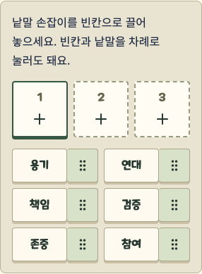

# 손으로 조작하는 사건 카드와 공동 기록

2026-10-11 · 시작점 `a56df9c` · `feat/story-b`

`motion-advanced`와 선행 스킬 `motion-foundations`를 적용했다. 기존 MINO 문항·나레이션·판정 계약을 유지하면서 사건 카드와 공동 기록의 낱말에 직접 조작을 추가했다. 새 스킬 설치는 Codex 전역 설정이며 게임 저장소에는 구현 파일과 Motion 의존성만 포함한다.

## 플레이 변화

| 장면 | 직전 동작 | 새 동작 |
|---|---|---|
| 사건 순서 | 사건을 고른 뒤 위·아래 버튼으로 이동 | 손잡이를 잡으면 카드가 손가락을 따라 움직이고 다른 카드가 자리를 내준다. 버튼 이동도 유지 |
| 공동 문장 | 빈칸 선택 후 낱말 누르기 | 낱말 손잡이를 빈칸으로 끌면 목적지가 강조되고, 놓으면 해당 자리에 반영. 원래 누르기 조작도 유지 |
| 취소 | 별도 드래그 없음 | Esc·창 초점 이탈·백그라운드 전환 시 드래그 정리. 사건 순서는 시작 전 초안으로 복원 |
| 동작 줄이기 | 기존 페이드 중심 | 새 이동 연출과 손잡이를 끄고 누르기·화살표로 같은 작업을 수행. 실행 중 설정 변경도 즉시 반영 |

손잡이만 `touch-action: none`으로 처리해 카드의 설명 부분에서는 스크롤할 수 있다. 모든 새 손잡이는 44px 이상이며 이동 결과를 짧은 상태 문구로 알린다. 낱말은 빈칸 밖에 놓으면 초안을 변경하지 않는다. 낱말 조합에 정답 판정을 추가하지 않으며 어떤 단어를 고를지도 미리 채우지 않는다.

배치·드래그는 개인 초안만 바꾼다. 사건의 정답 판정은 기존 제출 버튼과 서버가 맡고, 공동 문장은 저장·네 보직 동의를 거쳐 확정된다. 미션 완료를 모션 종료에 종속시키지 않는다. 추모의 벽, 음원, 3D 지도, 기존 5개 코스, 비공개 판정 자료는 변경하지 않았다.

공개 낱말만 표시한 초기 배치판이다. 개인 회고·실제 정답·완성 문장은 포함하지 않는다.

## 구현 근거

- [Motion 공식 Reorder 문서](https://motion.dev/docs/react-reorder): 세로 목록의 순서 변경과 별도 손잡이를 구현할 때 참고했다.
- [Motion 공식 Drag 문서](https://motion.dev/docs/react-drag): 낱말의 직접 이동과 원위치 복귀를 구현할 때 참고했다.
- 스프링·지속 시간·배율은 `motion-tokens.ts`에 모았다. 기존 봉투의 Web Animations API 구현은 이번에 다시 작성하지 않았다.
- 설치된 Motion 14.1.0의 `useReducedMotion`은 최초 값만 상태로 저장하므로 OS 설정 변경을 놓쳤다. 새 컴포넌트는 `useSyncExternalStore`로 미디어 쿼리를 구독하고, 서버에서는 동작 줄이기를 기본값으로 사용한다. 순서 목록은 `MotionConfig`와 CSS로 이동을 끈다.
- 게임의 의존성은 `motion/react`에서 가져온다. 잠금 파일의 `framer-motion`은 Motion 패키지 내부 의존성이며 별도로 혼용하지 않는다.
- 기존 다른 체크아웃의 패키지를 바꾸지 않도록 독립 임시 런타임을 만들었다. 로컬 `node_modules`와 `.next` 링크를 같은 런타임으로 연결하고 비공개 실행 설정·방 데이터는 보존했다. 새 환경에서는 `web`에서 `npm ci`로 설치한다.

## 검증

| 검사 | 결과 |
|---|---|
| `npx tsc --noEmit -p .` | 통과 |
| `npx vitest run` | 43개 파일·374개 시험 통과 |
| `NEXT_PUBLIC_BACKEND=local npm run build` | 통과 |
| Chrome·WebKit 전체 E2E | 9개 통과·WebKit 드래그 1개 실패, 3.8분 |
| WebKit 정상 완주 재시험 | 입력 안정화 후 1개 통과, 1.0분 |
| Chrome 정상 완주 재확인 | 최종 시험 방식으로 1개 통과, 46.8초 |
| `git diff --check`·클라이언트 비공개 표식 검사 | 통과·관련 표식 0개 |

전체 실행에서 통과한 나머지 8개 항목과 두 브라우저의 정상 완주 재시험을 합쳐 10개 항목의 통과를 확인했다. 전체 10개를 다시 한 번에 실행한 결과로 표시하지 않는다. 로컬 3013은 최종 빌드로 실행했고 HTTP 200을 확인했다.

전체 E2E 명령은 `PLAYWRIGHT_STORY_B_URL=http://127.0.0.1:3014 npx playwright test --config playwright.story-b.config.ts`이며, 재시험은 여기에 `--project=webkit` 또는 `--project=chromium`과 `--grep 'normal solutions'`를 붙였다.

정상 풀이 시험에 공개 선택지로 만든 임의 초안의 드래그 검사를 추가했다. 마우스 순서 변경, Chrome CDP의 터치 시작·이동·종료 입력, Esc 취소, 키보드 이동, 낱말 배치, 동작 줄이기를 확인한다. 정답이나 개인 기록을 드래그 시험·캡처에 복제하지 않는다. 드래그 손잡이가 보이는 상태에서도 폭 320·360·375·390·412·430px와 글자 100·130%를 검사한다.

네 독립 세션의 정상 풀이·해설 경로는 정문 13개 조사 → 용봉관 12개 조사 → 기존 추모의 벽 → 봉지 → 최종 결과를 검증한다. 혼자 체험·나레이션·기존 봉투 모션 검사도 전체 E2E에 포함한다. 도착은 모의 도착이다.

초기 타입 검사에서 Reorder의 `layout`에 `false`를 전달할 수 없다는 오류를 수정했다. 첫 빌드는 `.next`의 기존 임시 폴더가 이전 Next.js 패키지를 참조하여 prerender 오류가 났고, 임시 빌드와 패키지 경로를 일치시켜 해결했다. 첫 드래그 E2E는 동작 줄이기 설정 변경 후 손잡이가 나타나지 않아 실패했으며, 미디어 쿼리 구독으로 수정한 뒤 Chrome 정상 완주 시험이 통과했다. 전체 검사에서는 WebKit의 순서 변경 검사 한 곳이 실패했다. 화면 폭 변경 직후 곧바로 마우스를 이동하던 시험을 손잡이의 안정화 후 프레임별로 입력하도록 수정했고, 제품 코드 추가 변경 없이 WebKit 정상 완주 재시험이 통과했다.

## 변경 파일과 1차 대비 차이

| 파일 | 변경 |
|---|---|
| `web/components/story-order.tsx` | 사건 순서 카드의 드래그·취소·버튼 대체 조작 |
| `web/components/story-step-input.tsx` | Story B 순서 문항에 새 카드 컴포넌트 연결 |
| `web/components/story-mission.module.css` | 손잡이·들어 올린 카드·동작 줄이기 스타일 |
| `web/components/story-sentence.tsx` | 낱말 끌기·빈칸 강조·드롭·취소·기존 누르기 조작 |
| `web/components/closing-v2.tsx` | 저장 중·오래된 공동 기록 편집의 낱말 조작 비활성화 |
| `web/components/closing-v2.module.css` | 작은 화면의 낱말·44px 손잡이·드롭 목적지 스타일 |
| `web/lib/motion-tokens.ts` | 모션·스프링 공통 값 |
| `web/lib/use-motion-preference.ts` | SSR와 실시간 동작 줄이기 설정 구독 |
| `web/package.json`, `web/package-lock.json` | Motion 14.1.0 의존성 추가 |
| `web/tests/e2e/check-story-drag.ts`, `web/tests/e2e/story-b.spec.ts` | 4인 완주 중 드래그·터치·취소·키보드·반응형 검사 |
| `docs/story-b/README.md`, `INTERACTIVE-CLUES.md` | 실행 환경·개편·검증 기록 |
| `docs/story-b/images/drag-word-tray.png` | 공개 낱말 배치판의 실제 화면 |

1차 `965239e`의 텍스트·입력 중심 흐름에서, 새 코스는 보직 도구·단서 개봉·기록 수집을 거쳐 직접 카드를 조작하는 방식으로 발전했다. 누적 스토리·파일 차이는 [README](README.md#1차-결과와-파일-비교), 이전 모션은 [MOTION-POLISH](MOTION-POLISH.md)를 참고한다.

## 남은 확인

실제 휴대전화의 손가락 조작감·오래 끌 때의 편안함·야외 가독성은 별도 확인이 필요하다. 터치 에뮬레이션을 실제 휴대전화 시험으로 간주하지 않는다. 실제 폰 4대·현장 GPS·학습 효과 시험도 수행하지 않았다. 새 인물·연도·장소 주장은 추가하지 않았고 기존 역사·현장 검수 항목은 유지한다. 새 게임 규칙이나 정답은 추가하지 않았다.
