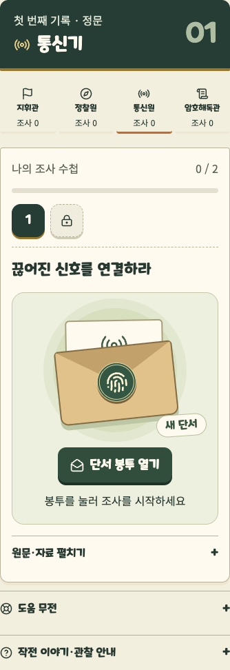
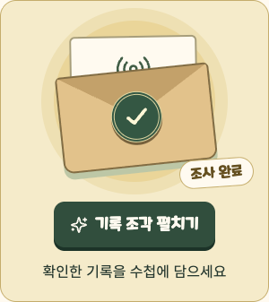
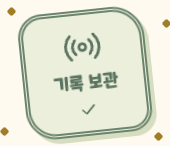

# 단서 발견과 기록 수집 개편

2026-10-11 · 시작점 `873a333` · `feat/story-b`

## 공식 자료 조사

게임의 공식 도움말·소개 페이지와 연결된 화면 자료를 참고했다. 앱을 직접 실행해 프레임별 동작을 측정한 것은 아니다. 아래 시간과 곡선은 호국실록을 위한 설계값이며, 원작의 실제 애니메이션 수치가 아니다. 원작 캐릭터·아이콘·배경·음원을 가져오지 않았다.

| 게임 | 확인한 구조 | 호국실록에 적용한 판단 |
|---|---|---|
| [브롤스타즈 — Quests](https://support.supercell.com/brawl-stars/en/articles/quests-3.html) | 작은 목표가 별도 퀘스트 화면에 모이고, 특정 브롤러 퀘스트를 누르면 해당 브롤러가 선택된다. 완료는 패스 진행에 연결된다. | 조사 수첩에서 단서를 골라 그 도구로 바로 들어가고, 서버 완료 수를 진행 막대에 반영한다. |
| [클래시 로얄 — Lucky Chests & Boxes](https://support.supercell.com/clash-royale/en/articles/lucky-chests-6.html) | 보상 상자를 직접 눌러 개봉한다. 원작에는 탭에 따른 희귀도 상승 확률이 있다. | 손으로 누르는 개봉 동작만 참고한다. 여기서는 한 번 눌러 고정된 조사 기록을 펼치며 확률·등급·새 화폐를 도입하지 않는다. |
| [포켓몬 GO — Types of Research](https://niantic.helpshift.com/hc/en/6-pokemon-go/faq/45-types-of-research/) | 장소에서 얻은 과제, 진행 알림, 과제 완료 후 보상 받기, 도장 누적과 더 큰 보상이 연결된다. | 단서 도착 → 조사 → 기록 조각 펼치기 → 도장 수첩 → 공동 사초의 짧은 고리를 만든다. 일일 제한·출석 연속 조건은 가져오지 않는다. |
| [동물의 숲 — Nook Miles 공식 안내](https://play.nintendo.com/news-tips/tips-tricks/animal-crossing-new-horizons-discover-tips/) · [NookPhone 안내](https://animalcrossing.nintendo.com/new-horizons/explore/) | 일상의 활동이 작은 도전이 되고, NookPhone에 목표와 수집한 것들이 남는다. 공식 Nook Miles 화면은 항목 목록과 개별 항목의 기록을 보여준다. | 보직의 행동을 종이 도구로 표현하고, 완료한 단서에 보관 도장을 남겨 다시 열어볼 수 있게 한다. |

현재 도움말은 지역·버전·시험 대상에 따라 실제 화면과 다를 수 있다. 2024년 클래시 로얄 Lucky Drops 자료는 검색에서 확인했지만 현재 보상 명칭·구조를 설명하는 근거로 사용하지 않았다.

## 구현

1. **단서 봉투:** 새로 열린 조사에 바로 입력란을 표시하지 않고, 보직 문양이 든 종이 봉투를 표시한다. 한 번 누르면 조작 도구가 나온다. 대기 중인 단서는 서버 선행 조건을 충족해야 열 수 있다.
2. **조사 수첩:** 완료 수와 진행 막대는 서버 상태로 표시한다. 완료했지만 아직 펼치지 않은 조각은 황금색, 확인해 보관한 조각은 녹색 도장으로 구분한다. 색 외에 체크·접근성 이름으로도 구분한다.
3. **기록 조각:** 서버가 완료를 확인한 뒤 보상 봉투가 나타난다. 직접 펼치면 보직 도장과 기존 보상 설명이 나온다. 새 보상·역사 자료를 만들거나 판정값을 공개하지 않는다.
4. **손맛:** 봉투를 누르는 반응, 판정 도장·연결 핀의 작은 눌림, 실제 보고 상태의 표시 전환을 추가했다.
5. **공동 사초:** 정문·용봉관의 자물쇠 해제 뒤 네 보직 문양과 기록책이 모인다. 추모의 벽에는 적용하지 않는다.

수집 버튼은 보상을 확인하는 표현이며 서버의 진행 조건이 아니다. 조각을 펼치지 않아도 다음 조사·보고로 갈 수 있고 완료한 단서를 다시 골라 확인할 수 있다. 자동 처리·해설 경로도 이 연출 때문에 멈추지 않는다.

## 모션·접근성

봉투 개봉과 기록 도장은 드물게 발생하는 상태 전환·확인 피드백이다. 열기 240ms, 도장 240ms, 눌림 120~160ms, 진행 220ms. 사초 문양은 160ms에 40ms씩 순차 등장하여 전체 280ms 안에 끝난다. 곡선은 `cubic-bezier(0.23, 1, 0.32, 1)`. 움직이는 속성은 transform·opacity이고, 봉투 모양의 clip-path는 고정이다. 추가 라이브러리는 없다.

키보드로 봉투를 열 때 이동 연출을 하지 않는다. `prefers-reduced-motion`에서는 개봉·사초가 160ms 투명도 전환으로 대체되고, 진행 막대와 눌림의 이동은 즉시 반영한다. 호버 이동은 마우스 같은 정밀 포인터에서만 켠다. 모든 연출 동안 다음 조작이 가능하며 강제 대기나 전체 화면 팝업을 추가하지 않았다.

## 상태·개인정보

- sessionStorage에 방·거점·보직별 **알려진 단계 ID의 개봉/보관 여부만** 저장한다. 정답·개인 기록·신호·숫자·GPS는 저장하지 않는다.
- 같은 탭을 새로고침하면 다시 개봉하지 않는다. 탭 세션 종료·저장 차단 시에는 재개봉할 수 있으나 서버 진행은 유지된다.
- 저장값을 바꿔도 잠긴 조사·서버 완료 상태를 바꿀 수 없다. 완료 여부를 sessionStorage로 판단하지 않는다.
- 단서를 옮겨 다니거나 화면을 복원할 때 수집 연출을 불필요하게 반복하지 않는다.
- 기존 다섯 코스, 정답 판정, 추모의 벽, 음원, 3D 지도는 이번 작업에서 변경하지 않는다.

## 검증

| 검사 | 결과 |
|---|---|
| `npx tsc --noEmit -p .` | 통과 |
| `npx vitest run` | 42개 파일·372개 시험 통과 |
| `NEXT_PUBLIC_BACKEND=local npm run build` | 통과 |
| `PLAYWRIGHT_STORY_B_URL=http://127.0.0.1:3014 npx playwright test --config playwright.story-b.config.ts` | Chrome·WebKit 8개 통과, 3.7분 |
| `git diff --check` | 통과 |
| 클라이언트 빌드 비공개 로더·정답 해시 관련 표식 검사 | 0개 |

초기 Chrome 정상 풀이 시험은 동작 줄이기 확인에서 두 번 실패했다. 기존 전역 `animation: none !important`가 새 페이드까지 끄고 있어, 새 개봉·도장·사초에만 이동 없는 페이드를 명시적으로 허용했다. 시험은 CSS 이름 대신 실제 지속 시간과 키프레임에 이동이 없는지를 확인하도록 보완했다.

네 독립 브라우저 세션으로 정상 풀이 25단계를 진행했다. 각 단서의 봉투 열기·입력·서버 완료·조각 펼치기, 보고·자물쇠·공동 사초를 거쳐 정문 → 용봉관 → 기존 추모의 벽 → 봉지 → 최종 결과까지 통과했다. 해설 경로·혼자 보직 전환·나레이션도 별도로 통과했다. 도착은 모의 도착이며 실제 GPS 시험은 아니다.

새 개봉 UI의 axe 검사, 320·360·375·390·412·430px / 글자 100·130% 가로 넘침 검사, 마우스 개봉의 240ms 연출, 키보드 개봉의 즉시 표시, 동작 줄이기의 160ms 페이드와 이동 없음, 개봉·보관 후 새로고침 복원, 저장값 변조로 잠금을 해제할 수 없음, 추모 후 사초에 새 연출이 없음도 확인했다. 과거 보직 도구와 공동 문장의 접근성 검사는 그대로 포함했다.

최종 빌드를 3013에 다시 실행했고 HTTP 200을 확인했다. 기존 비공개 실행 설정·방 데이터는 유지했다. 미해결 타입·빌드·자동 시험 실패는 없다.

실제 휴대전화의 손맛·야외 가독성·재미와 학습 효과, 현장 GPS는 별도 확인 대상이다. 새 역사적 사실·인물·연도는 추가하지 않았다.

## 실제 화면

통신원의 새 단서 봉투, 완료 후 펼치기 버튼, 보관 도장이다. 실제 정답·보상 설명·개인 입력은 담지 않았다. 첫 캡처는 도구 전체를 보여주기 위해 높이를 늘렸고, 모바일 검사는 별도로 844px 높이에서 진행했다.

## 이번 변경 파일

| 파일 | 변경 |
|---|---|
| `web/components/story-discovery.tsx` | 봉투·도장·사초 조합과 선택적 개봉 기억 |
| `web/components/story-discovery.module.css` | 원본 종이 소품·개봉·수집 모션 |
| `web/lib/story-discovery.ts` | 저장값 검증·방/거점/보직 격리 |
| `web/components/story-challenge.tsx` | 조사 시작·완료에 개봉 연결 |
| `web/components/story-mission.tsx` | 조사 수첩·진행 막대·보관 표시 |
| `web/components/story-mission.module.css` | 수첩·도구 눌림·보고 반응 |
| `web/components/game-app.tsx` | Story B 정문·용봉관 사초에 공동 연출 연결 |
| `web/tests/story-discovery.test.ts` | 손상된 저장값·허용 ID·범위 분리 검증 |
| `web/tests/e2e/story-b.spec.ts` | 개봉·보관·복원·동작 줄이기·키보드·완주 검사 |
| `docs/story-b/README.md`, `QUEST-DISCOVERY.md` | 조사 출처·구현·검증 기록 |
| `docs/story-b/images/quest-envelope.png`, `quest-reward.png`, `quest-stamp.png` | 비공개 내용 없는 실제 화면 3장 |

1차 `965239e`와의 전체 스토리 차이는 [README](README.md), 직전 텍스트 개편은 [GAMEPLAY-REDESIGN.md](GAMEPLAY-REDESIGN.md)를 참고한다. 이번 변경은 25개 조사·서버 계약을 유지하면서 단서가 등장하고 기록이 남는 경험을 바꾼다.
