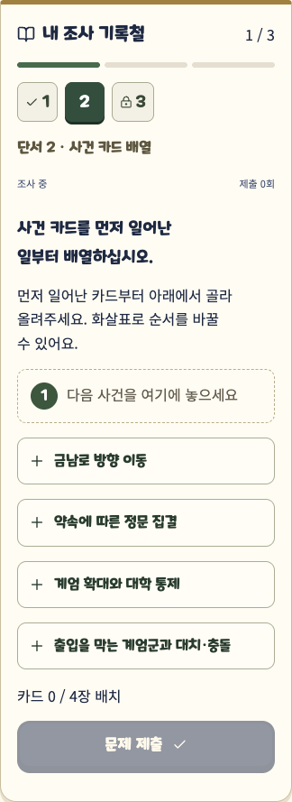
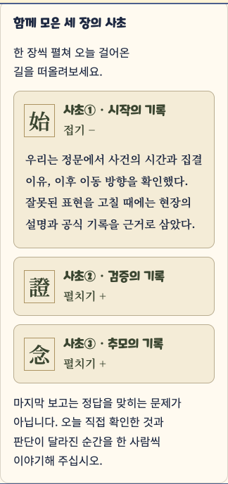

# MINO 최신 자료 적용과 UI/UX

2026-10-11. `GPS_MINO_1st_scenario_current.md`, FE README, API 계약, 정문 Snapshot 12종을 대조했다. 비공개 원본 대본과 정답은 저장소에 복사하지 않는다. 합성·가림 처리가 된 Snapshot만 기존 fixtures를 갱신했다. 자료의 배포 안내는 배포 권한으로 취급하지 않는다.

## 화면 기준

기존 보직 인식표의 메이플스토리체·올리브색, 이동 지도의 탐방 분위기, 사초 화면의 종이색·Noto Serif를 연결한다. 참고한 화면은 기존 보직/미션/사초이며 외부 게임의 구조나 자산을 복제하지 않는다.

- 보직 안내 → 네 사람의 보고 상황 → 현재 단서 → 조사 완료 기록 → 말로 보고.
- 조사 기록철은 한 번에 한 문항. 번호로 돌아갈 수 있고 미제출 초안은 단서 전환 중 유지한다. 새로고침·보직 전환 후 초안 복구는 제공하지 않는다.
- OX는 보고서 위의 선택 버튼, 사건 순서는 카드를 골라 올리고 화살표로 이동. 키보드로도 동일하게 조작한다.
- 연결 과제는 전체 근거 카드와 항목별 선택, 기록은 문항에서 요구한 필드만 유지한다.
- 보상·정오 판정·진행은 서버 응답 뒤 표시한다. 선택 모양은 정답 여부를 뜻하지 않는다.
- 봉지는 펼쳐 보는 사초 세 장 → 개인 회고 → 낱말로 조합한 공동 문장 → 전원 동의. 경쟁·시간 제한을 추가하지 않는다.
- 320~430px, 본문 16px 이상, 터치 44px 이상, 한글 어절 줄바꿈, 동작 줄이기 설정을 지원한다.

## 새 문서 반영

| 항목 | 적용 |
|---|---|
| 공통 확인 입력 | main·verify에서 제거. submit-step의 method/source 생략 허용, 과거 요청 검증·기록 보존 |
| 확인 방식 | 누락을 현장/해설로 추정하지 않음. 기록첩·허용된 전달 기록은 null, 결과 methods는 빈 배열 허용 |
| G-01 근거 | 정답 짝 연결에서 reason 필수 자유 기록으로 교체. 순서 과제는 자동 채점 유지 |
| 힌트 정책 | 새 story-b만 0/10/10, 무힌트 보너스 0. UI는 코스 응답을 읽음 |
| 공동 문장 | 선택적 sentenceParts 계약 지원. 조합 미리보기와 제출 본문 일치 검증, 같은 내용 재저장 시 동의 보존 |
| 추모의 벽 | 사용자의 우선 지시로 기존 묵념·국화. 새 문서의 인물 문제·공동 추모 문장 제외 |
| 보직 | 일반 4인 방 최초 보직 유지. 기존 로컬 혼자 체험의 보직 전환만 유지 |
| GPS·사진·음성 | 현장 검증 완료로 표시하지 않음. 원본 사진 부재로 관찰 메모·공식 자료, 음성 대신 기존 자막 사용 |

기존 다섯 코스, 음원, 3D 지도는 이번 변경에서 수정하지 않는다. 기존 방의 코스는 바뀌지 않으며 새 코스를 확인하려면 새 방을 만든다.

## 남은 확인

현장 안내판·역사 사진의 권리와 촬영 시기, 추모 거점 GPS, 실제 네 기기의 동기화·야외 GPS는 미확정이다. 새로운 인물·연도·장소 사실은 추가하지 않았다. 시간 점수·랭킹·사진 업로드는 구현하지 않았다. 나레이션은 기존 MINO 자막을 유지한다.

## 1차 결과와 비교

| 부분 | 1차 965239e | 이번 상태 |
|---|---|---|
| 이야기 | 기존 보직별 문제 | MINO 25문항·역할별 선행 조사·코스별 자막 유지, 최신 근거 자유 기록 반영 |
| 조사 화면 | 역할별 입력 화면 | 현재 단서 중심 기록철·팀 보고 상태·OX 판정 카드·사건 카드 조작·완료 안내 |
| 입력 | 공통 확인 방식·출처 입력 | 문항 자체의 기록만 요구. 이전 유효 기록·응답 격리는 유지 |
| 추모 | 묵념·국화 헌화 | 동일. 새 시나리오의 인물 문제 제외 |
| 봉지·결과 | 회고·공동 기록·결과 | 사초를 펼쳐 복기, 선택 낱말로 문장 조합, 전원 동의 후 기록철 완성 표시 |
| 음원·지도 | 기존 자산 | 이번 UI 변경에서 수정 없음. 앞선 보행 개선은 WALKTHROUGH-POLISH.md에 별도 기록 |

## 실제 검증

- `npx tsc --noEmit -p .`: web 디렉터리에서 통과.
- `npx vitest run`: 40개 파일, 365개 시험 통과.
- `npm run build`: Next.js production 빌드 통과.
- `npx playwright test --config playwright.story-b.config.ts`: Chrome·WebKit 8개 시험 통과(3.3분). 일반 풀이, 해설 경로, 혼자 체험, 프롤로그·준비를 포함한다.
- 기존 main·verify 호환성 4개 시험도 모두 확인했다. `npx playwright test --config playwright.current-compat.config.ts`의 마지막 전체 실행은 3개 통과·1개 실패였고, 남은 새로고침 후 제목 선택자를 수정한 뒤 `--grep 'third-level role hints'`로 해당 1개를 재실행해 통과했다(23.7초). 합성 코스의 정상 풀이·분리 보고·부분 잠금 복구·힌트 응답 유실 재시도·해설 동의·저장소 격리를 검사했다.
- 일반 풀이 시험은 쿠키가 분리된 네 context에서 정문 13문항·용봉관 12문항의 실제 UI 입력을 수행한다. 실제 키는 테스트 프로세스의 서버 비공개 파일에서 읽고 로그·추적·스크린샷에 남기지 않는다. 각자 보고 → 잠금 → 추모 소개·묵념·네 헌화 → 봉지 개인 회고 → 공동 문장·네 동의 → 결과·재접속을 확인했다. 도착은 모의이고 실제 휴대전화 시험은 아니다.
- 320/360/375/390/412/430px, 글자 100/130%에서 문항·추모·회고·결과의 가로 넘침을 검사했다. 새 주파수·사건 카드 영역의 axe WCAG 2A/AA·2.1AA 검사 오류 0. 모든 화면의 수동 스크린리더 검증을 뜻하지 않는다.
- 중간 실패: 문장 조각을 선택 필드로 처리하지 않아 기존 코스 검증 7건이 실패했고 수정 후 모두 통과. 첫 브라우저 시험에서 조합 끝의 빈칸 때문에 공동 기록 저장이 거절되어 공통 조합 함수로 수정했다. 빌드와 병행한 타입 검사는 생성 타입 삭제와 경합했으며, 빌드 완료 후 위 명령을 단독 재실행해 통과했다.
- 기존 화면 호환성 시험을 추가하면서 오래된 합성 필드·완료 제목 선택자가 실제 화면과 달라 실패했다. 필드의 `plain` 표시와 코스의 실제 이름을 사용하도록 시험을 수정했다. 검증 화면에 불필요한 브라우저 환경 설정을 주입해 저장소 격리 검사가 실패한 것도 시험 설정에서 제거했다. 저장소 검사 자체를 완화하지 않았다.
- 보호 코스 5개·음원은 965239e 대비 동일. 추모 컴포넌트와 지도는 이번 작업 시작점 대비 동일. 클라이언트 빌드에 서버 코스 생성기·비공개 파일 경로·정답 해시 배열이 포함되지 않는지 검사했다.

최종 작은 수정 후 일반 풀이만 Chrome·WebKit에서 다시 실행했다: `npx playwright test --config playwright.story-b.config.ts --grep 'story-b normal'` 2개 통과(1.5분). 카드의 키보드 선택·위로 이동·삭제와 단서 전환 중 미제출 입력 유지도 포함했다.

## 이번 변경 파일

이 목록은 이번 요청 시작 커밋 `8e11318`부터의 변경이다. 이전 MINO·보행 작업과 1차 전체 비교는 README와 WALKTHROUGH-POLISH에 따로 남아 있다.

| 파일 | 변경 목적 |
|---|---|
| `docs/be/API_CONTRACT.md` | 적용 범위·새 계약·검증·미확정 내용 기록 |
| `docs/be/fixtures/get-stage.gate.cipher.after-hint.json` | 선배가 전달한 합성 Snapshot 계약 갱신 |
| `docs/be/fixtures/get-stage.gate.cipher.before-hint.json` | 선배가 전달한 합성 Snapshot 계약 갱신 |
| `docs/be/fixtures/get-stage.gate.cipher.stage-completed.json` | 선배가 전달한 합성 Snapshot 계약 갱신 |
| `docs/be/fixtures/get-stage.gate.commander.after-hint.json` | 선배가 전달한 합성 Snapshot 계약 갱신 |
| `docs/be/fixtures/get-stage.gate.commander.before-hint.json` | 선배가 전달한 합성 Snapshot 계약 갱신 |
| `docs/be/fixtures/get-stage.gate.commander.stage-completed.json` | 선배가 전달한 합성 Snapshot 계약 갱신 |
| `docs/be/fixtures/get-stage.gate.scout.after-hint.json` | 선배가 전달한 합성 Snapshot 계약 갱신 |
| `docs/be/fixtures/get-stage.gate.scout.before-hint.json` | 선배가 전달한 합성 Snapshot 계약 갱신 |
| `docs/be/fixtures/get-stage.gate.scout.stage-completed.json` | 선배가 전달한 합성 Snapshot 계약 갱신 |
| `docs/be/fixtures/get-stage.gate.signal.after-hint.json` | 선배가 전달한 합성 Snapshot 계약 갱신 |
| `docs/be/fixtures/get-stage.gate.signal.before-hint.json` | 선배가 전달한 합성 Snapshot 계약 갱신 |
| `docs/be/fixtures/get-stage.gate.signal.stage-completed.json` | 선배가 전달한 합성 Snapshot 계약 갱신 |
| `docs/fe/README.md` | 적용 범위·새 계약·검증·미확정 내용 기록 |
| `docs/story-b/MINO-COVERAGE.md` | 적용 범위·새 계약·검증·미확정 내용 기록 |
| `docs/story-b/README.md` | 적용 범위·새 계약·검증·미확정 내용 기록 |
| `docs/story-b/UIUX-CURRENT.md` | 적용 범위·새 계약·검증·미확정 내용 기록 |
| `docs/story-b/images/ui-frequency.png` | 정답을 포함하지 않는 실제 UI 검증 캡처 |
| `docs/story-b/images/ui-order.png` | 정답을 포함하지 않는 실제 UI 검증 캡처 |
| `docs/story-b/images/ui-records.png` | 정답을 포함하지 않는 실제 UI 검증 캡처 |
| `web/components/closing-v2.module.css` | 조사 기록철·조작·회고 화면 또는 공통 입력 간소화 |
| `web/components/closing-v2.tsx` | 조사 기록철·조작·회고 화면 또는 공통 입력 간소화 |
| `web/components/frequency-tuner.module.css` | 조사 기록철·조작·회고 화면 또는 공통 입력 간소화 |
| `web/components/journal-v2.tsx` | 조사 기록철·조작·회고 화면 또는 공통 입력 간소화 |
| `web/components/mission-v2.module.css` | 조사 기록철·조작·회고 화면 또는 공통 입력 간소화 |
| `web/components/mission-v2.tsx` | 조사 기록철·조작·회고 화면 또는 공통 입력 간소화 |
| `web/components/story-mission.module.css` | 조사 기록철·조작·회고 화면 또는 공통 입력 간소화 |
| `web/components/story-mission.tsx` | 조사 기록철·조작·회고 화면 또는 공통 입력 간소화 |
| `web/components/story-step-input.tsx` | 조사 기록철·조작·회고 화면 또는 공통 입력 간소화 |
| `web/components/verify-mission.tsx` | 조사 기록철·조작·회고 화면 또는 공통 입력 간소화 |
| `web/playwright.current-compat.config.ts` | 최신 계약·입력 조작·기존 화면 호환성 검증 |
| `web/supabase/functions/_shared/closing-v2.ts` | 새 코스·공통 입력/문장 조합·누락 확인 방식 처리 |
| `web/supabase/functions/_shared/engine-v2.ts` | 새 코스·공통 입력/문장 조합·누락 확인 방식 처리 |
| `web/supabase/functions/_shared/prepare-course-v2.ts` | 새 코스·공통 입력/문장 조합·누락 확인 방식 처리 |
| `web/supabase/functions/_shared/project-course-v2.ts` | 새 코스·공통 입력/문장 조합·누락 확인 방식 처리 |
| `web/supabase/functions/_shared/project-journal-v2.ts` | 새 코스·공통 입력/문장 조합·누락 확인 방식 처리 |
| `web/supabase/functions/_shared/record-sentence.ts` | 새 코스·공통 입력/문장 조합·누락 확인 방식 처리 |
| `web/supabase/functions/_shared/story-b-course-v2.ts` | 새 코스·공통 입력/문장 조합·누락 확인 방식 처리 |
| `web/supabase/functions/_shared/types.ts` | 새 코스·공통 입력/문장 조합·누락 확인 방식 처리 |
| `web/supabase/functions/_shared/yongbong-v2.ts` | 새 코스·공통 입력/문장 조합·누락 확인 방식 처리 |
| `web/tests/api-v2.test.ts` | 최신 계약·입력 조작·기존 화면 호환성 검증 |
| `web/tests/e2e/full-course.spec.ts` | 최신 계약·입력 조작·기존 화면 호환성 검증 |
| `web/tests/e2e/integrated-v2.spec.ts` | 최신 계약·입력 조작·기존 화면 호환성 검증 |
| `web/tests/e2e/legacy-gate-v2.spec.ts` | 최신 계약·입력 조작·기존 화면 호환성 검증 |
| `web/tests/e2e/story-b-solo.spec.ts` | 최신 계약·입력 조작·기존 화면 호환성 검증 |
| `web/tests/e2e/story-b.spec.ts` | 최신 계약·입력 조작·기존 화면 호환성 검증 |
| `web/tests/e2e/verify-v2.spec.ts` | 최신 계약·입력 조작·기존 화면 호환성 검증 |
| `web/tests/e2e/yongbong-v1.spec.ts` | 최신 계약·입력 조작·기존 화면 호환성 검증 |
| `web/tests/e2e/yongbong.spec.ts` | 최신 계약·입력 조작·기존 화면 호환성 검증 |
| `web/tests/mino-current-contract.test.ts` | 최신 계약·입력 조작·기존 화면 호환성 검증 |
| `web/tests/story-b.test.ts` | 최신 계약·입력 조작·기존 화면 호환성 검증 |
